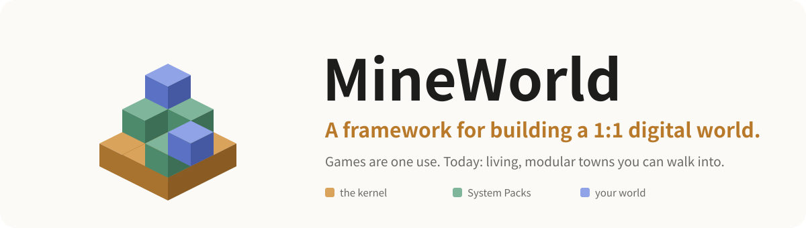
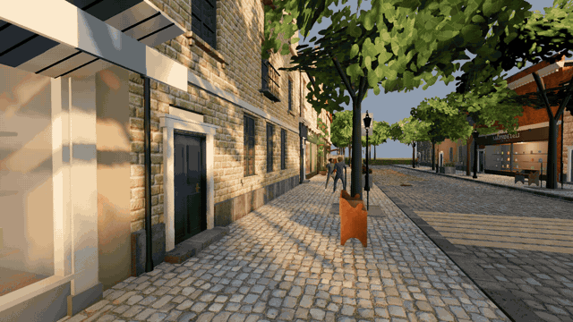

<p align="center">
  <picture>
    <source media="(prefers-color-scheme: dark)" srcset="docs/assets/readme/hero-en-dark.svg">
    
  </picture>
</p>

<p align="center">
  <a href="https://github.com/yuema137/MineWorld/actions/workflows/ci.yml"></a>
  <a href="LICENSE"></a>
  
  
  
  
  
  
</p>

<p align="center">
  <b>English</b> · <a href="README.zh-CN.md">简体中文</a>
  <br>
  <a href="#quick-start">Quick start</a> ·
  <a href="#the-big-idea-an-interaction-list-for-people">The big idea</a> ·
  <a href="#how-it-works">How it works</a> ·
  <a href="#whats-in-the-box">What's in the box</a> ·
  <a href="#scope">Scope</a> ·
  <a href="docs/VISION.md">Vision</a>
</p>

<p align="center">
  
  <br><sub>From the street to the café counter, in frames captured from the 3D client.</sub>
</p>


<table>
  <tr>
    <td width="50%"></td>
    <td width="50%"></td>
  </tr>
  <tr>
    <td align="center"><sub><b>3D</b>: walk up to Alice and press E. She remembers what you said.</sub></td>
    <td align="center"><sub><b>2D</b>: the same town, the same server, the same menu of actions.</sub></td>
  </tr>
</table>

**MineWorld is an open-source framework for building a 1:1 digital world, a persistent world of
people, places, rules and physics that you can walk into. Games are one use of it.** Today it builds
living, modular towns, such as a café town and a lakeside village, whose people work, shop, talk,
remember and keep living while nobody is logged in. You play them in 2D or 3D, with friends, or
alongside AI agents that follow exactly the same rules you do. The full 1:1 scope is the
[direction](#scope), not today's state.

- **Compose, don't fork.** A world is a list of packs and a few text files. Money, jobs, bodies and
  weather are each a module. The small kernel never learns what a job is.
- **One authoritative world.** Every view, every AI character and every outside agent asks the same
  server. Every change is recorded with its cause, survives a crash, and replays exactly.
- **Alive with or without AI.** Characters can run on a language model with their own memory, or on a
  plain script. Unplug every model and the world still works.

## The big idea: an Interaction List for people

Particle physicists don't write a new simulator for every experiment. In
[Geant4](https://geant4.web.cern.ch) they pick a **physics list**: which processes act on which
particles. MineWorld does the same for a human world. A world's
[Interaction List](docs/MODULE_SPEC.md#42-the-worlds-interaction-list) says which interactions exist,
between whom, under which rules. Same engine, different list, different world.

<picture>
  <source media="(prefers-color-scheme: dark)" srcset="docs/assets/readme/physics-list-en-dark.svg">
  
</picture>

## How it works

<picture>
  <source media="(prefers-color-scheme: dark)" srcset="docs/assets/readme/one-world-en-dark.svg">
  
</picture>

<picture>
  <source media="(prefers-color-scheme: dark)" srcset="docs/assets/readme/compose-en-dark.svg">
  
</picture>

<details>
<summary><b>The life of one action</b>: what happens when you buy a coffee</summary>
<br>
<picture>
  <source media="(prefers-color-scheme: dark)" srcset="docs/assets/readme/action-life-en-dark.svg">
  
</picture>
</details>

## Quick start

You need [Rust](https://rustup.rs) (the right version installs itself) and
[Godot 4.7](https://godotengine.org) on your `PATH`.

```sh
git clone https://github.com/yuema137/MineWorld && cd MineWorld
./mineworld-2d               # the market town in 2D: click to walk, click a person for a menu
./mineworld-slice --world    # walk into the café in 3D, press E at the counter to talk to Alice
```

No graphics at all? Run a world for 30 days of game time, or make your own:

```sh
cargo run -p mineworld-cli -- run worlds/market-town --headless --seed 7 --days 30
cargo run -p mineworld-cli -- create my-world
```

Play from a program with [`clients/agent`](clients/agent/README.md) (Python, or MCP for Claude Code and
other agents). Give characters a language model with
[`cognition/lm-controller`](cognition/lm-controller/README.md). Every setting a world can use is in the
generated [reference](docs/reference/README.md).

## What's in the box

| | | |
| --- | --- | --- |
| 🧱 **Kernel** ✅<br><sub>time, space, events, persistence, replay; deterministic on macOS, Linux and Windows</sub> | 🧩 **18 System Packs** ✅<br><sub>talk, friends, items, shops, jobs, wages, food, bodies, date, weather, and a third-party fishing pack</sub> | 📜 **Interaction List** ✅<br><sub>who may do what to whom, per world, as data</sub> |
| 🗺️ **2D client** ✅<br><sub>walk, talk, invite, buy, give, eat, all through server menus</sub> | 🏙️ **3D client** ✅<br><sub>walk, run, jump, enter the café, talk to Alice · 🚧 the full street, shopping</sub> | 🧠 **AI characters** ✅<br><sub>a local or online model, each person's own memory and forgetting · 🚧 shared memory</sub> |
| 🤖 **Agents as players** ✅<br><sub>Python library and MCP; the same seat rules as a human · 🚧 remote over HTTP</sub> | 👥 **Play together** ✅<br><sub>invite codes, reconnects, a hosted town that lives while nobody is online</sub> | 🧬 **People with depth** 🚧<br><sub>a curated attribute catalogue, population sampling, optional MatrAIx backend</sub> |

✅ works on `main` and is tested · 🚧 designed and being built. Live detail:
[`docs/MVP_STATUS.md`](docs/MVP_STATUS.md).

## Scope

The café town is the first composition, not the product. MineWorld is meant to grow into a 1:1
digital world: each new domain, from markets to politics to autonomous driving, arrives as more packs,
never as a bigger kernel.

<picture>
  <source media="(prefers-color-scheme: dark)" srcset="docs/assets/readme/scope-en-dark.svg">
  
</picture>

| Stage | What | Status |
| --- | --- | --- |
| **MVP-0** | one town that lives, in 2D and 3D, alone, with friends or with agents | ✅ mostly built · 🚧 finishing |
| **Next** | many towns linked by train, bus and taxi; maps; real terrain and water | 🗺 planned ([`VISION.md` §5](docs/VISION.md#5-roadmap-beyond-the-mvp)) |
| **Later** | World Creator, a pack ecosystem, public living worlds | 🗺 planned |
| **Long-term** | trading, markets, politics, autonomous-driving tests | 🔭 direction, not commitment ([`VISION.md` §7](docs/VISION.md#7-long-term-scope-direction-recorded-2026-10-18)) |

## Learn more

- [`docs/VISION.md`](docs/VISION.md): why this exists and where it is going
- [`docs/ARCHITECTURE.md`](docs/ARCHITECTURE.md) and [`docs/CORE_CONCEPTS.md`](docs/CORE_CONCEPTS.md): how the parts fit, and the words we use
- [`docs/MODULE_SPEC.md`](docs/MODULE_SPEC.md): how to write packs, including the Interaction List
- [`docs/reference/`](docs/reference/README.md): every field a world may set, generated from the code

**Built with** Rust · Godot 4.7 · Python · SQLite · the Model Context Protocol.

**Contributing.** Read [`CLAUDE.md`](CLAUDE.md) and [`docs/ENGINEERING_RULES.md`](docs/ENGINEERING_RULES.md);
`python3 scripts/ci_layer.py fast` runs the quick checks. If you want worlds like this to exist, a ⭐
helps other people find the project.

## License

MIT, except the Blender scripts in `clients/3d-spike/tools/blender/` (GPL-2.0-or-later, because they use
Blender's GPL interface). Art from other people is CC0. Where every piece of art came from, including
the parts made with AI tools, is listed in [`NOTICE`](NOTICE). The screenshots and diagrams in
`docs/images/readme/` and `docs/assets/readme/` were made for this project.
