<p align="center">
  <picture>
    <source media="(prefers-color-scheme: dark)" srcset="docs/images/readme/hero-en-dark.svg">
    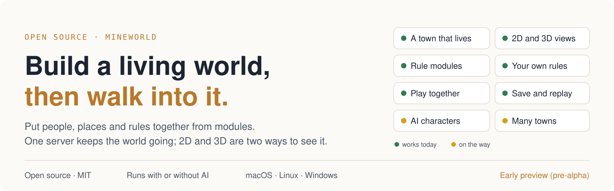
  </picture>
</p>

<p align="center">
  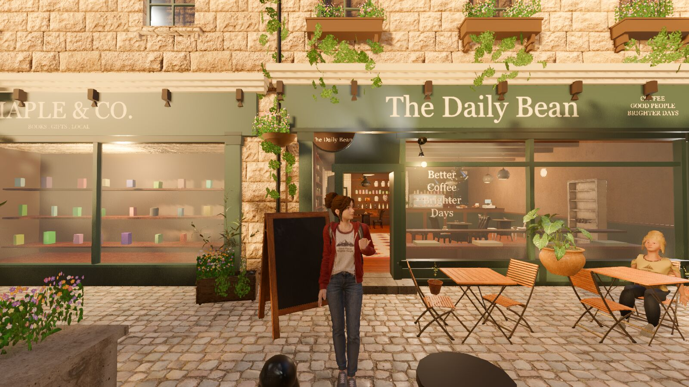
</p>

<p align="center">
  <a href="LICENSE"></a>
  <a href="https://github.com/yuema137/MineWorld/actions/workflows/ci.yml"></a>
  
  
  
  
</p>

<p align="center">
  <b>English</b> · <a href="README.zh-CN.md">简体中文</a>
</p>

<p align="center">
  <a href="#what-makes-it-different">Why MineWorld</a> ·
  <a href="#how-a-world-is-built">How it works</a> ·
  <a href="#one-world-two-views">Two views</a> ·
  <a href="#humans-and-ai-agents-play-the-same-game">Agents</a> ·
  <a href="#people-with-depth-pluggable-person-generation-now-with-matraix">People</a> ·
  <a href="#product-tour">Tour</a> ·
  <a href="#what-works-today">Status</a> ·
  <a href="#quick-start">Quick start</a> ·
  <a href="#where-it-is-going">Roadmap</a>
</p>

**Build a living world, then walk into it.** MineWorld is an open-source framework for persistent
game worlds made from modules: towns whose people work, shop, gossip, remember and keep living while
nobody is logged in. You play them in 2D or 3D, with friends, or alongside AI agents that play by
exactly the same rules you do.

The café town in these pictures ships with MineWorld and is ready to play. It is one world you can
build, not the product itself.

> MineWorld is pre-alpha. Everything below is marked ✅ (works on `main`, tested) or 🚧 (designed and
> being built). Nothing marked 🚧 is something you can use yet.

## What makes it different

| | |
| --- | --- |
| **A framework, not a game** | You compose worlds: install modules, write a few text files, configure, run. You never fork a game and edit its code. ✅ |
| **Rules are modules** | Money, jobs, friendship, bodies and weather are each a module that owns its own part of the world. Turn one off and its actions vanish while the rest of the town keeps working. The small core never learns what a job or money is. ✅ |
| **Humans and AI agents are both players** | An agent takes a seat through the same door as a person, sees only what that person sees, and gets the same refusals. The server cannot tell them apart. ✅ Python library · 🚧 MCP adapter for Claude Code and other agents |
| **People who remember** | Every person keeps their own memory of what they saw and heard, forgets the way people do, and stays within a bounded memory budget. They can run on a language model, a simple script, or a no-AI decision model. ✅ · 🚧 shared memory |
| **People with depth** | Each person can carry rich attributes (chronotype, diet, temperament, skills…) drawn from a realistic population. Use MineWorld's own catalogue, or switch on MatrAIx's 1,290-dimension persona schema. 🚧 |
| **A real economy** | Money, shops, wages and stock exist today. ✅ Next: currency as data, every seller sets their own price, haggling, and a market reporter whose price notices people subscribe to. 🚧 |
| **Persistent worlds** | Every change is recorded with its cause. A world survives a crash, replays identically from the same seed, and gives the same results on macOS, Linux and Windows. ✅ |
| **One world, two views** | The 2D and 3D views are two windows onto one server. Neither invents its own rules. ✅ |

## How a world is built

<picture>
  <source media="(prefers-color-scheme: dark)" srcset="docs/images/readme/how-it-works-en-dark.svg">
  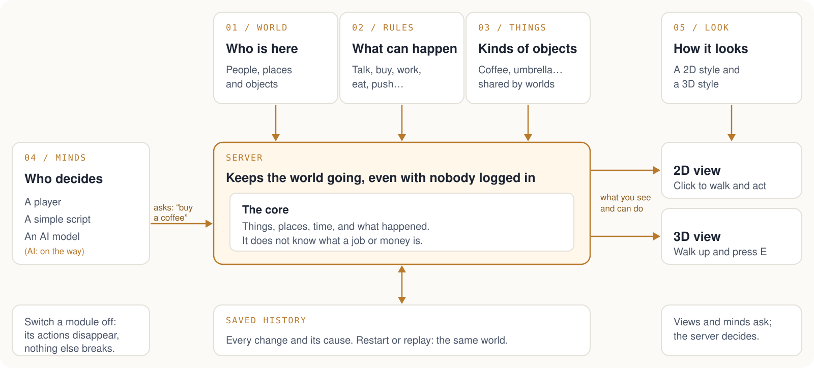
</picture>

A world is built from five kinds of packs. A pack is a folder you add
([`docs/MODULE_SPEC.md`](docs/MODULE_SPEC.md)):

1. **World**: who is in it. People, places and objects, written as short text files.
2. **Rule modules**: what can happen. Each owns its own part of the world. If the jobs module needs
   Alice to be paid, it says "Alice's wages are due", and only the money module moves money.
3. **Kinds of things**: coffee, umbrellas, books. Several worlds can share them.
4. **Minds**: who decides what a character does. A player, a script, an AI model, or an outside agent.
5. **Look**: how the world is drawn. A 2D style and a 3D style.

<details>
<summary><b>The rule modules that exist today</b></summary>

```text
presence        where people are, and what each of them can see
movement        walking, and which places connect
conversation    talking, and remembering who said what
group-activity  inviting people and doing things together
relationships   who knows whom, and how well
naming          what people are called
schedule        each person's daily plan
item            what kinds of objects exist
inventory       who is carrying what
item-transfer   giving things to each other
employment      jobs and shifts
economy         money, shops and wages
consumption     eating and drinking
bodies          bodies that cannot overlap; push, kick, throw, shove; walking around furniture
calendar        the date and the sun
weather         the weather, hour by hour, or replayed from a real weather station
fishing         the first module made outside this project, kept in its own repository
```

Example worlds: [`worlds/social-cafe`](worlds/social-cafe) (a café town),
[`worlds/market-town`](worlds/market-town) (the same town with belongings, jobs, money and food),
[`worlds/bodies-yard`](worlds/bodies-yard) (two rooms where people and boxes get in each other's
way).

A world lists its modules in `world.yaml`. The market town is the café town with six lines added:

```yaml
systems:
  - presence
  - movement
  - conversation
  # … the rest of the café town
  - item
  - inventory
  - item-transfer
  - economy
  - employment
  - consumption
```

To write a new rule module, add a folder under `systems/` and two lines under `systems/installed/`,
then rebuild ([`systems/README.md`](systems/README.md), "Adding a pack").

</details>

## One world, two views

<picture>
  <source media="(prefers-color-scheme: dark)" srcset="docs/images/readme/two-views-en-dark.svg">
  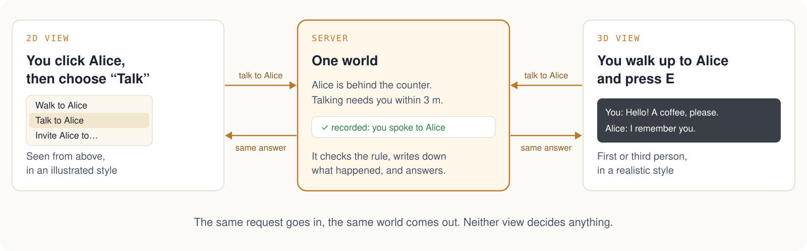
</picture>

The server answers every request with what happens, or with why not ("too far away", "not allowed
here"). **One morning in the market town:**

1. At 05:30 Alice's shift starts and she walks to the café counter, because her daily plan says so.
2. You walk in and open your menu. "Buy coffee" is on it, because the money module offers it to anyone
   inside a shop.
3. You choose it. The server checks your wallet, takes the price, gives you a coffee, and records what
   happened and why.
4. The café has one coffee fewer. Every other player sees it, and it is still true after a restart.
5. At 14:00 the jobs module reports that Alice's wages are due; the money module pays her. She walks
   to the park.

Today you buy in the 2D view; buying in 3D is being built. Switch the money module off and step 2
never appears, while the rest of the town still works.

## Humans and AI agents play the same game

An outside agent (an agent framework, a script, soon Claude Code or Codex) is a **player**, not a
puppet with admin powers. It joins a seat with an invite, sees that person's own view, picks from the
offers the world makes, and the server checks every request exactly as it does for a human. A human can
take over an agent's seat and the other way round. The world never waits for anyone to think.

| | Status |
| --- | --- |
| Python `Player` library ([`clients/agent`](clients/agent/README.md)): join, observe, act, resume after a dropped connection, with an information-rich view (money, items, job, agenda, acquaintances, invitations, weather, prices) | ✅ [#204](https://github.com/yuema137/MineWorld/pull/204) |
| Seat grants (a host gives an agent named seats only) and a per-seat request budget, the same for humans and agents | ✅ [#205](https://github.com/yuema137/MineWorld/pull/205) |
| An MCP adapter, so Claude Code and other MCP agents play over stdio; a scripted MCP play-test on all three platforms | 🚧 designed and frozen ([step 27](.structured-coding/plans/mvp0/step-27-agent-players.md)) |
| Remote agents over Streamable HTTP; a tutorial chapter "play as an agent" | 🚧 designed |

## People with depth: pluggable person generation (now with MatrAIx)

A town feels alive when its people differ in ways you notice: who is up at dawn, who orders oat milk,
who talks your ear off, who can bake. MineWorld gives every person **attributes** as plain data, drawn
from a realistic population, and lets each world choose **where those people come from**.

> 🚧 **Status: designed and approved by the operator on 2026-10-15; implementation in progress.**
> Every part below, the MatrAIx backend and its demo included, is release-blocking for MVP-0.
> Design: [step 30](.structured-coding/plans/mvp0/step-30-person-attributes.md).

- **A built-in, curated catalogue.** At most 100 attributes in six groups (appearance, background,
  psychology, capability, behaviour, lifestyle). Each one is kept only if something in play reads it:
  a decision, a conversation, a price, the way a person looks.
- **Your own attributes with zero code.** Drop a YAML file into a world's `attributes/` folder and
  `freckles` exists, can be sampled, and appears in what others see.
- **Realistic populations.** A world names a population profile with cited sources. One deterministic
  sampler fills the cast and never overrides what a person's own file says.
- **Pluggable backends with masks.** A world picks a person-generation backend and a mask that selects
  which attributes exist in that world. What a mask leaves out does not exist at all: no prompt, view or
  panel can carry it.
- **Seen by everyone the same way.** What you could notice about a person appears in the 2D and 3D
  inspect panels, in an AI character's "who I see", and in an agent's view of that person.

### MatrAIx as an optional backend

[MatrAIx](https://github.com/MatrAIx-ai/MatrAIx-Persona-8B) is a large-scale persona model: its schema
describes people in **1,290 dimensions across five groups** (background, psychology, capability,
behaviour and interaction, lifestyle), each value with a natural-language phrase, with labels in six
locales including Simplified Chinese. MineWorld will let any world switch it on:

```yaml
# worlds/<your-world>/configure/attributes.yaml
backend: matraix          # default: mineworld
mask: matraix-core-100    # or: all
```

- **Imported unchanged.** Their MIT-licensed schema is pinned to an exact upstream commit and checked
  byte for byte; ids, values, phrases and locale labels are kept as they are.
- **Masks.** `matraix-core-100` (the default) picks about 100 dimensions that change play, each with
  the reason it was chosen. `all` turns on every imported dimension. 50 dimensions that carry their own
  narrower licence statement are left out until their terms are confirmed, so `all` means 1,240 today.
- **A demo world**, `worlds/matraix-demo`, shows MatrAIx people in casting, in AI characters' "who I am"
  and "who I see", in an agent's view, and in both inspect panels, including in Chinese. A guide chapter
  walks through switching the backend on and back off.
- **Never a hard dependency.** It is a separate pack, not installed by default. MineWorld builds and
  passes its full test suite without it, and nothing outside that pack depends on it.

*Optional person-generation backend built on the MatrAIx persona schema (Li, Hao et al., 2026,
[arXiv 2608.04205](https://arxiv.org/abs/2608.04205); MIT), imported unchanged.* Thank you to the
MatrAIx authors for releasing their schema openly: see their paper, *MatrAIx: Simulating the World
with 8.3 Billion Persona Agents*, and their
[repository](https://github.com/MatrAIx-ai/MatrAIx-Persona-8B).

## Living people

| | Status |
| --- | --- |
| Each person's own memory: what they perceived, compressed over time, recalled by relevance | ✅ [#143](https://github.com/yuema137/MineWorld/pull/143) |
| Forgetting that people would recognise: fading acquaintances, pluggable forgetting policies, optional summaries by a model; at most 20 MiB per person by default | ✅ [#186](https://github.com/yuema137/MineWorld/pull/186), [#188](https://github.com/yuema137/MineWorld/pull/188), [#201](https://github.com/yuema137/MineWorld/pull/201), [#213](https://github.com/yuema137/MineWorld/pull/213) |
| Pluggable decision models per person, including a bundled one that uses no AI at all | ✅ [#191](https://github.com/yuema137/MineWorld/pull/191), [#210](https://github.com/yuema137/MineWorld/pull/210) |
| An AI character driven by a language model: one on your own computer by default, or one of 11 online services with your own key; tests replay recorded answers, never a live model | ✅ [#120](https://github.com/yuema137/MineWorld/pull/120), [#126](https://github.com/yuema137/MineWorld/pull/126), [#207](https://github.com/yuema137/MineWorld/pull/207) |
| Memory shared across a town and stored once, where perception is the only access right | 🚧 specified ([step 28](.structured-coding/plans/mvp0/step-28-shared-memory.md)) |
| Every person built to the protagonist's standard, from pluggable character sources | 🚧 in review ([step 26](.structured-coding/plans/mvp0/step-26-cast.md)) |
| Changing clothes and hair, starting outfits, buying clothes | 🚧 designed ([step 32](.structured-coding/plans/mvp0/step-32-wardrobe.md)) |

## Product tour

All pictures are taken in this project's own 2D and 3D views.

| | |
| --- | --- |
| 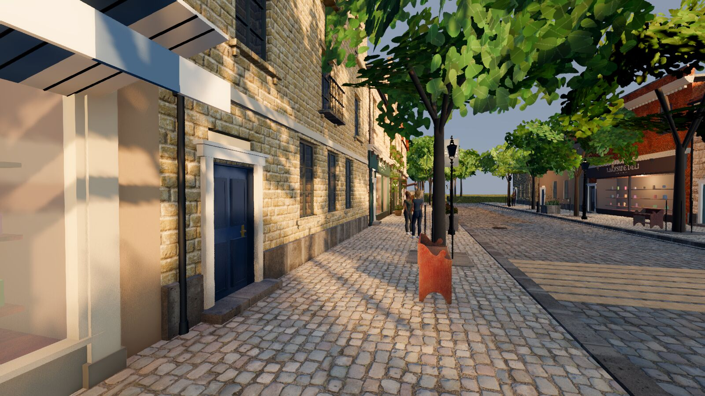 | 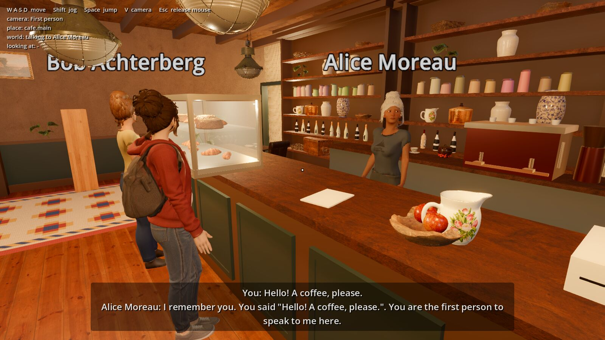 |
| **The main street, 3D.** Walk in first or third person. | **Talking to Alice, 3D.** Connected to a running server; she remembers what you said. |
| 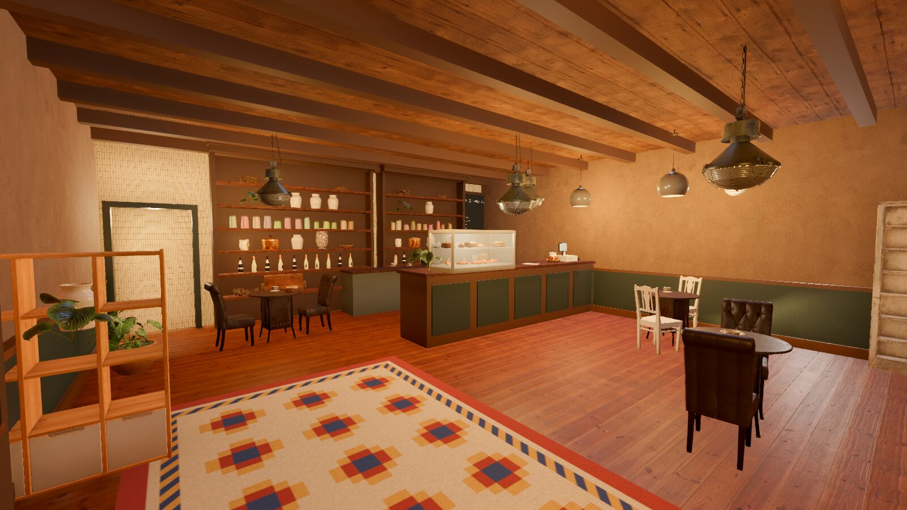 | 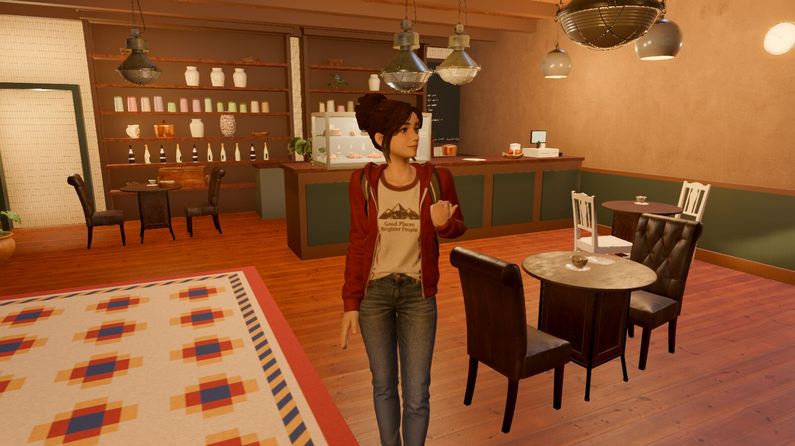 |
| **Inside the café, 3D.** Walk in through the front door and look around. | **Your character, 3D.** The default player character in the café. |
| 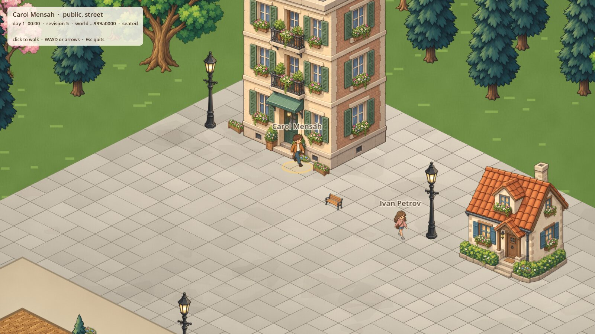 | 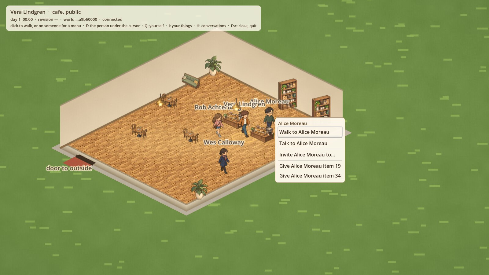 |
| **The same town, 2D.** Seen from above, with the people who live there. | **A menu from the server, 2D.** What you can do with Alice right now. |
| 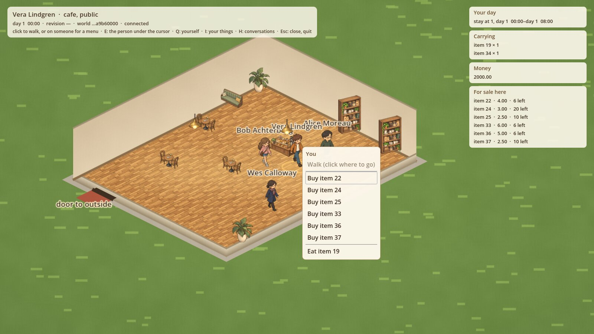 | 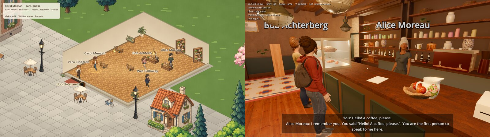 |
| **Shopping, 2D.** Your money, what you carry, and what is for sale here. | **One café, two views.** The same world, drawn twice. |

## What works today

✅ works on `main` and is tested · 🚧 designed and being built · 🗺 planned for the next stage

| Area | Status |
| --- | --- |
| **The core** | ✅ the world clock, activities that take time, and a full record of every change and its cause, stored compressed. A world survives a crash and replays identically from the same seed |
| **Building from blocks** | ✅ checked by tests: the market town is the café town plus six rule modules and some settings, with no change to the core. Remove any one of them and the town still runs |
| **Everyday life** | ✅ people walk, talk, meet, become friends, do things together, own and give things, work shifts, get paid, buy, eat and drink, for 300 days of game time |
| **Bodies** | ✅ people and objects never pass through each other; push, kick, throw and shove; walks planned around walls and furniture · 🚧 walls in the towns |
| **Time and weather** | ✅ the date, the day of the week, sunrise and sunset; hour-by-hour weather, which the market town replays from a real San Diego weather station · 🚧 showing the weather in the 2D and 3D views |
| **Living people** | ✅ memory, forgetting, a 20 MiB bound per person, pluggable decision models, AI characters on a local or online model · 🚧 shared memory, Alice remembering in 3D what you told her in 2D |
| **Agents as players** | ✅ the Python `Player` library, seat grants, a request budget for every seat · 🚧 the MCP adapter |
| **Person attributes** | 🚧 the curated catalogue, your own attributes, population sampling, the optional MatrAIx backend and its demo |
| **Economy** | ✅ money, shops, stock and wages · 🚧 currency as data, seller-set prices, haggling, a price reporter and public notices ([step 31](.structured-coding/plans/mvp0/step-31-wealth-prices.md)) |
| **Your own rules** | ✅ the first adjustable rules (for example, how soon someone can speak again) · 🚧 rules for the other modules, world events, and two example worlds: a manor with strict manners, and an ice rink |
| **Add-ons** | ✅ every module has a name, a version and a licence; a world says which versions it needs; new kinds of objects without rebuilding; a module from another repository, pinned to an exact version |
| **Playing together** | ✅ invite codes, nicknames, a 30-second grace period to reconnect, a player taking over an AI character, a host who can pause or remove players; a hosted town keeps living while nobody is connected; each person is told only what they could see or hear · 🚧 a test with four players at once |
| **2D view** | ✅ (preview) walk, use doors, talk, invite, buy, give, eat and drink, all through menus the server provides |
| **3D view** | ✅ walk, run, jump, enter the café and talk to Alice on a running server · 🚧 the whole street built from the server's map, shopping, smooth on ordinary computers, a distant view from every world |
| **The town** | 🚧 every town gets a station that is also its signature building; the market town's is modelled on San Diego's Santa Fe Depot ([step 29](.structured-coding/plans/mvp0/step-29-station-landmark.md)) |
| **Settings** | ✅ press Esc in either view: English or Simplified Chinese, 12- or 24-hour clock, window and display options, mouse sensitivity and invert-Y. Settings are shared by both views |
| **Creating worlds** | ✅ a generated reference for AI-character configuration; a runner that executes every tutorial step in CI · 🚧 the tutorial chapters themselves |
| **Computers** | ✅ the same world gives exactly the same results on macOS, Linux (Intel and ARM) and Windows, checked on every change · 🚧 the full test suite on Windows |
| **Many towns** | 🗺 next stage: several towns in one world, trains, buses and taxis, walking about on board, town and world maps |
| **Looking real** | 🗺 next stage: hills from real height data, water you can wade in, trees that move in the server's wind |

More detail: [`docs/MVP.md`](docs/MVP.md) (§9, the acceptance criteria) and
[`docs/MVP_STATUS.md`](docs/MVP_STATUS.md).

## Quick start

You need [Rust](https://rustup.rs) (the right version installs itself) and
[Godot 4.7](https://godotengine.org) on your `PATH`.

```sh
# 1. Get the code
git clone https://github.com/yuema137/MineWorld && cd MineWorld

# 2. Play the market town in 2D (click to walk, click a person for a menu, Q for your own menu,
#    Esc for settings, including 简体中文)
./mineworld-2d

# 3. Walk into the café in 3D and press E at the counter to talk to Alice
./mineworld-slice --world
```

Without any graphics, run the market town for 30 days of game time and read what happened:

```sh
cargo run -p mineworld-cli -- run worlds/market-town --headless --seed 7 --days 30
```

Make your own world, then add people, places and objects as text files and switch modules on in its
`world.yaml`:

```sh
cargo run -p mineworld-cli -- create my-world
cargo run -p mineworld-cli -- validate my-world
cargo run -p mineworld-cli -- run my-world --headless --seed 1 --days 7
```

To build a world step by step — two rooms, three people and a shop — follow the guide,
[`docs/guide/`](docs/guide/README.md). Every field a world's files may use is in the generated
[reference](docs/reference/README.md).

To play from a program, see [`clients/agent`](clients/agent/README.md). To give characters a language
model, see [`cognition/lm-controller`](cognition/lm-controller/README.md) and the generated
[configuration reference](docs/reference/cognition-toml.md).

**Which computers.** MineWorld is built for macOS, Linux and Windows; today it is developed and played
on macOS, and identical results on all three are checked automatically. To host the café town in
Docker: `docker build --target runtime -t mineworld .`, then
`docker run -p 7878:7878 -v mineworld:/var/lib/mineworld mineworld`.

## Where it is going

<picture>
  <source media="(prefers-color-scheme: dark)" srcset="docs/images/readme/roadmap-en-dark.svg">
  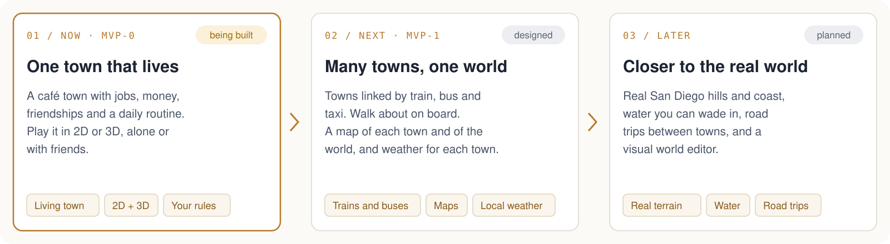
</picture>

**Before the first public release (MVP-0)**, everything marked 🚧 above: agents over MCP, shared
memory, person attributes with the MatrAIx backend, seller-set prices and haggling, a wardrobe, a
station and landmark in every town, a far field on every horizon, and every person built to the same
standard.

**After that:**

- **One big world made of many towns.** A trip takes time in the world; on the train you can walk
  about and talk to the other passengers.
- **Close to the real world.** Physical values come from real measurements with the source written
  down (a person is about 50 cm across at the shoulders). The sun follows the town's real location.
- **Your rules, your style, your characters.** The world's author picks the art style, the modules,
  and who may do what with whom. With no AI at all, the world still works.

The full picture is in [`docs/VISION.md`](docs/VISION.md).

## Read more

- [`docs/VISION.md`](docs/VISION.md): why this exists and where it is going
- [`docs/ARCHITECTURE.md`](docs/ARCHITECTURE.md): how the parts fit together
- [`docs/CORE_CONCEPTS.md`](docs/CORE_CONCEPTS.md): the words this project uses, defined
- [`docs/MODULE_SPEC.md`](docs/MODULE_SPEC.md) and [`docs/PACKAGE_FORMAT.md`](docs/PACKAGE_FORMAT.md): how to write packs
- [`CLAUDE.md`](CLAUDE.md) and [`docs/ENGINEERING_RULES.md`](docs/ENGINEERING_RULES.md): the rules
  every contribution follows; `python3 scripts/ci_layer.py fast` runs the quick checks locally

## License

MIT, except the Blender scripts in `clients/3d-spike/tools/blender/`, which are GPL-2.0-or-later
because they use Blender's GPL interface. Art from other people is CC0. Where every piece of art came
from, including the parts made with AI tools, is listed in [`NOTICE`](NOTICE). The screenshots and
diagrams in `docs/images/readme/` were made for this project.
