<p align="center">
  <a href="https://github.com/yuema137/MineWorld/releases/tag/promo-v2.2">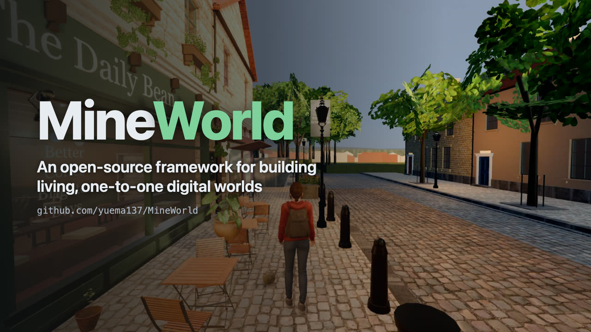</a>
  <br>
  <b><a href="https://github.com/yuema137/MineWorld/releases/download/promo-v2.2/mineworld-intro-v2.2.mp4">▶ Watch the 3-minute intro</a></b>
  <sub>(<a href="https://github.com/yuema137/MineWorld/releases/download/promo-v2.2/mineworld-intro-v2.2.en.srt">subtitles</a>)</sub>
</p>

<p align="center">
  <a href="https://github.com/yuema137/MineWorld/actions/workflows/ci.yml"></a>
  <a href="LICENSE"></a>
  
  
  
  
  
  
</p>

<p align="center">
  <b>English</b> · <a href="README.zh-CN.md">简体中文</a>
  <br>
  <a href="#one-world-many-players">One world</a> ·
  <a href="#a-town-that-lives-on-its-own">A living town</a> ·
  <a href="#new-worlds-same-engine">New worlds</a> ·
  <a href="#quick-start">Quick start</a> ·
  <a href="#whats-in-the-box">What's in the box</a> ·
  <a href="docs/VISION.md">Vision</a>
</p>

**MineWorld is an open-source framework for building living digital worlds: towns where people
work, talk and remember, whether they are played by you, by simple rules, or by AI.** You walk into
them in 2D or 3D, with friends, or next to AI agents that follow exactly the same rules you do.

<p align="center">
  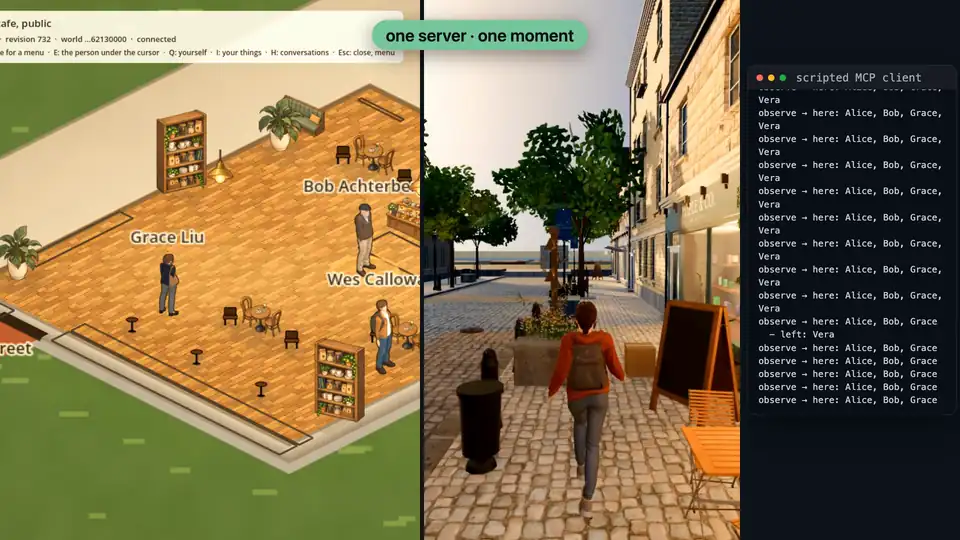
  <br><sub>One small town, three players at the same moment: one in 2D, one walking it in 3D, and an AI agent.</sub>
</p>

This town is not the product. It is one world built with the framework, and you can build your own.

## The idea: a physics list for people

Particle physicists don't rewrite their simulator for every experiment. In
[Geant4](https://geant4.web.cern.ch) they pick a **physics list**: which processes act on which
particles. MineWorld does the same for people. Entities are the particles, Systems are the processes,
and a world's [Interaction List](docs/MODULE_SPEC.md#42-the-worlds-interaction-list) picks which ones
that world uses. Same engine, different list, different world.

<picture>
  <source media="(prefers-color-scheme: dark)" srcset="docs/assets/readme/physics-list-en-dark.svg">
  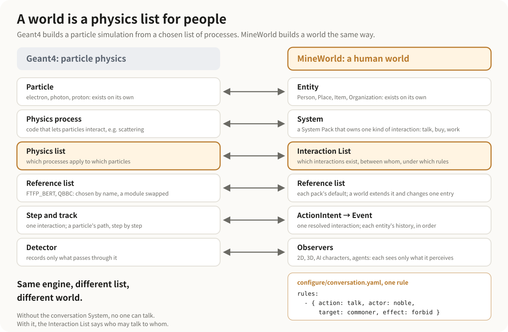
</picture>

That raises three questions. The rest of this page answers them with real footage.

## One world, many players

*How do 2D, 3D and AI players share one world without ever disagreeing?*

**Clients only ask. The server decides by the rules, and says why.** Vera says hello to Alice from
the doorway, and the server refuses: `too_far_away`. She walks up, and it goes through. No client
holds a rule.

<p align="center">
  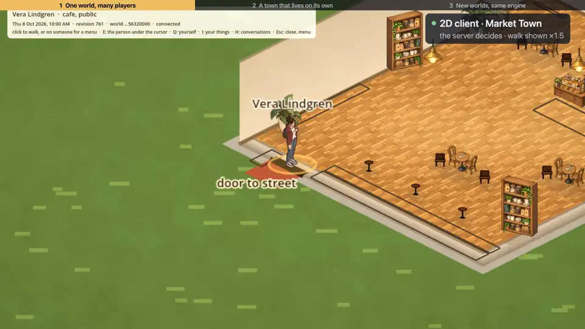
</p>

**One record, every view.** Vera buys a coffee in 3D. The economy System records it, so her wallet
in 2D already shows 2000.00 → 1999.20.

<table>
  <tr>
    <td width="50%">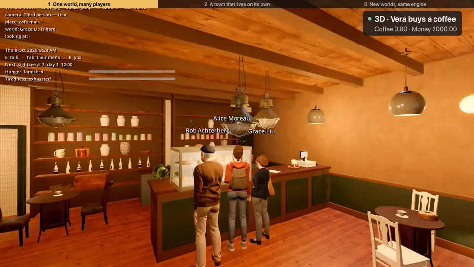</td>
    <td width="50%">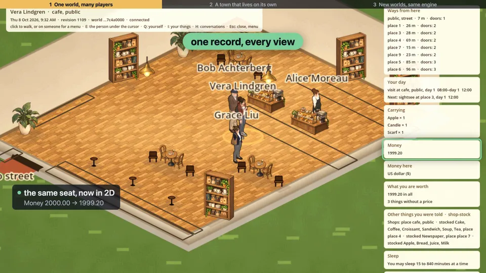</td>
  </tr>
  <tr>
    <td align="center"><sub><b>3D</b>: buy a coffee at the counter</sub></td>
    <td align="center"><sub><b>2D</b>: the same seat, the wallet already changed</sub></td>
  </tr>
</table>

**A crash can't erase a fact.** Every fact lives on the server. Kill it with `kill -9` mid-walk,
start it again, and the world carries on from the same revision. The client just reconnects.

<p align="center">
  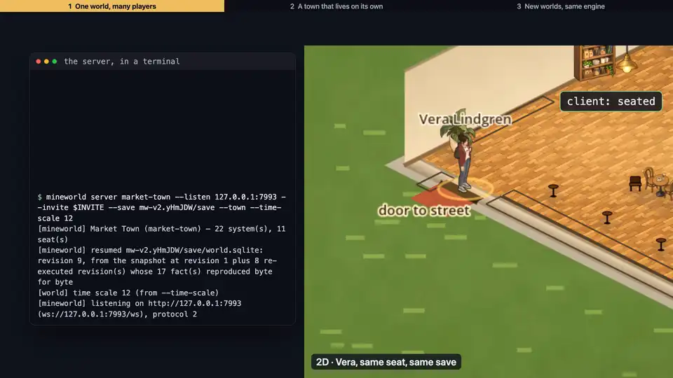
</p>

<details>
<summary><b>How it works</b>: one authoritative server, and the life of one action</summary>
<br>
<picture>
  <source media="(prefers-color-scheme: dark)" srcset="docs/assets/readme/one-world-en-dark.svg">
  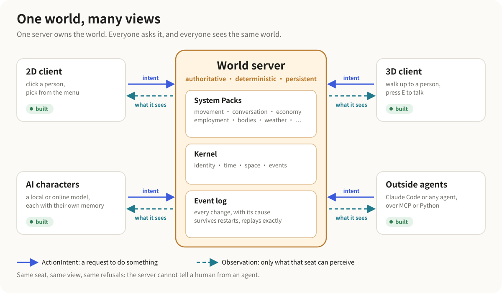
</picture>
<picture>
  <source media="(prefers-color-scheme: dark)" srcset="docs/assets/readme/action-life-en-dark.svg">
  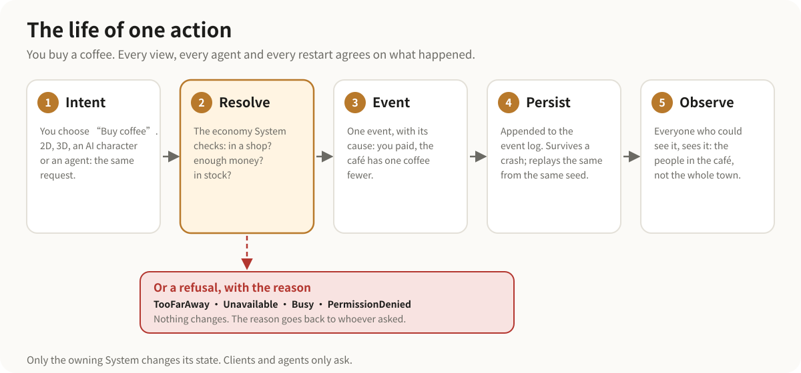
</picture>
</details>

## A town that lives on its own

*What keeps the town alive when nobody is playing?*

**Not a language model.** Unplug every model and simple rules still run the town: people go to work,
eat, walk home and sleep. This is Market Town at 17:00 with rule controllers only.

<p align="center">
  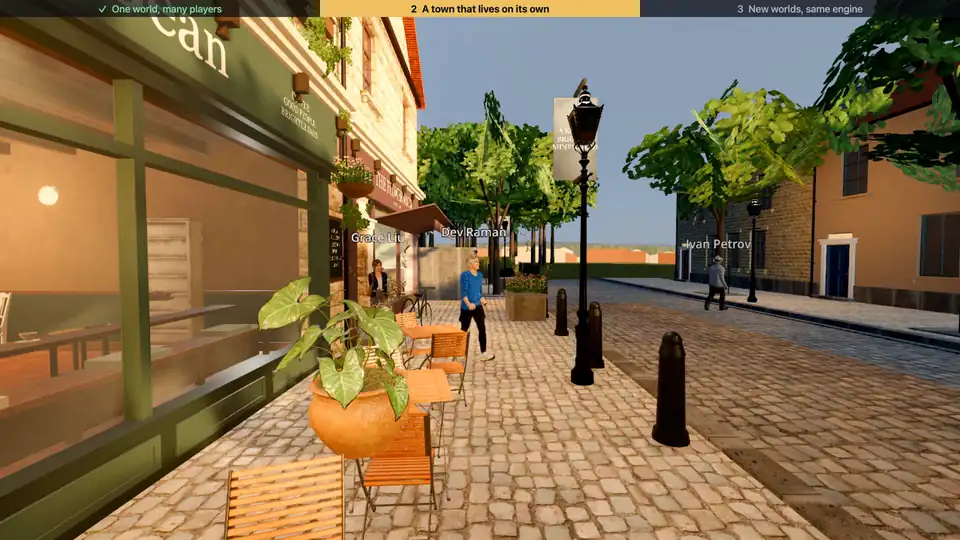
</p>

**Each person runs on a swappable controller**: plain rules, a motivated controller that weighs its
needs, a language model, an outside agent, or you. Swapping one never touches the world; it is a
line in a decisions file.

<p align="center">
  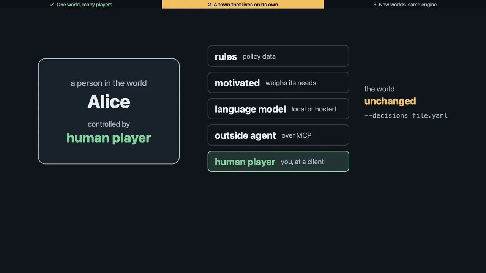
</p>

**A model is just one option.** Give Alice a local model and tell her some news in 2D. Later, in 3D,
she remembers it.

<p align="center">
  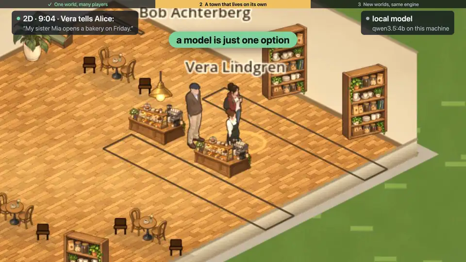
</p>

**Agents plug in the same way.** Claude Code joins over MCP, walks to the counter and buys a coffee,
under the same rules as you. Bob watches it happen in 2D.

<p align="center">
  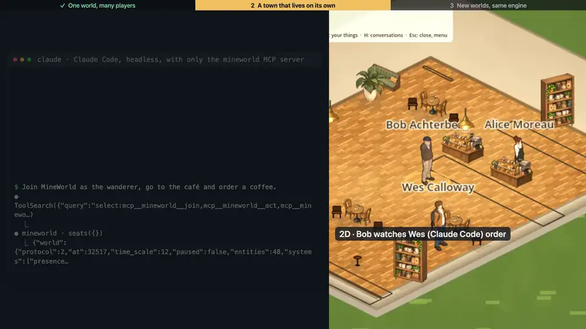
</p>

## New worlds, same engine

*How do you build a new world without rewriting the engine?*

**A world is a list of packs on a kernel that never changes.** This is the start of the café's real
Interaction List:

```console
$ mineworld interactions worlds/market-town --place cafe
interactions  Market Town (market-town)
section  conversation: default (compiled)
section  employment: default (compiled)
section  group-activity: default (compiled)
section  needs:
section  posture: default (compiled)
section  relationships: default (compiled)
section  sleep:
…
```

A social café lets you sit and chat. Add the economy packs, and the same café becomes a market town
that sells coffee. Add a third-party fishing pack, and it is a lake village. The kernel changes by
zero lines.

<p align="center">
  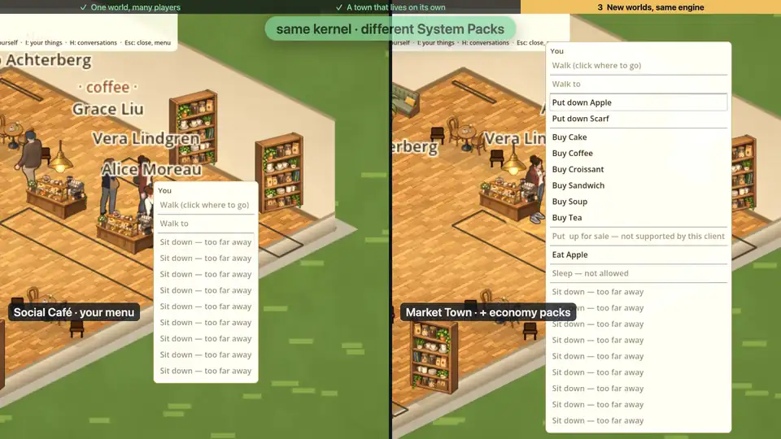
  <br><sub>Lakeside runs in 2D today; 🚧 its 3D view is in progress.</sub>
</p>

<details>
<summary><b>Three worlds, one kernel</b>: which packs each one uses</summary>
<br>
<picture>
  <source media="(prefers-color-scheme: dark)" srcset="docs/assets/readme/compose-en-dark.svg">
  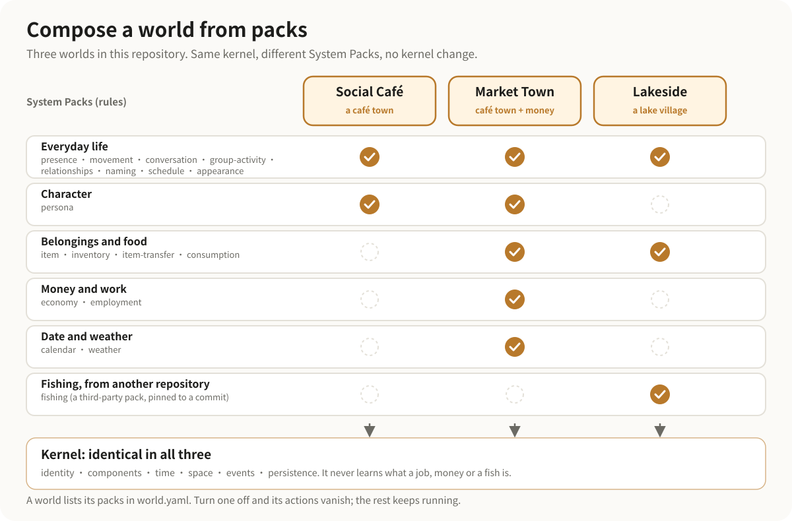
</picture>
</details>

Next come regions linked by train, then markets and institutions, one pack at a time
([scope](#scope)).

## Quick start

You need [Rust](https://rustup.rs) (the right version installs itself) and
[Godot 4.7](https://godotengine.org) on your `PATH`.

The 3D character models are stored with [Git LFS](https://git-lfs.com). Install it once:

- macOS: `brew install git-lfs`
- Linux (Debian or Ubuntu): `sudo apt install git-lfs`
- Windows: `winget install GitHub.GitLFS`

```sh
git lfs install             # once per computer
git clone https://github.com/yuema137/MineWorld && cd MineWorld
git lfs pull                # fetches the 3D character models
./mineworld-2d               # the market town in 2D: click to walk, click a person for a menu
./mineworld-slice --world    # walk into the café in 3D, press E at the counter to talk to Alice
```

No graphics at all? Run a world for 30 days of game time, or make your own:

```sh
cargo run -p mineworld-cli -- run worlds/market-town --headless --seed 7 --days 30
cargo run -p mineworld-cli -- create my-world
```

To build your own world step by step (two rooms, three people and a shop), follow the
[guide](docs/guide/README.md). Every command in it runs in CI on all three platforms.

Play from a program with [`clients/agent`](clients/agent/README.md) (Python, or MCP for Claude Code and
other agents). Give characters a language model with
[`cognition/lm-controller`](cognition/lm-controller/README.md). Every setting a world can use is in the
generated [reference](docs/reference/README.md).

## What's in the box

<p align="center">
  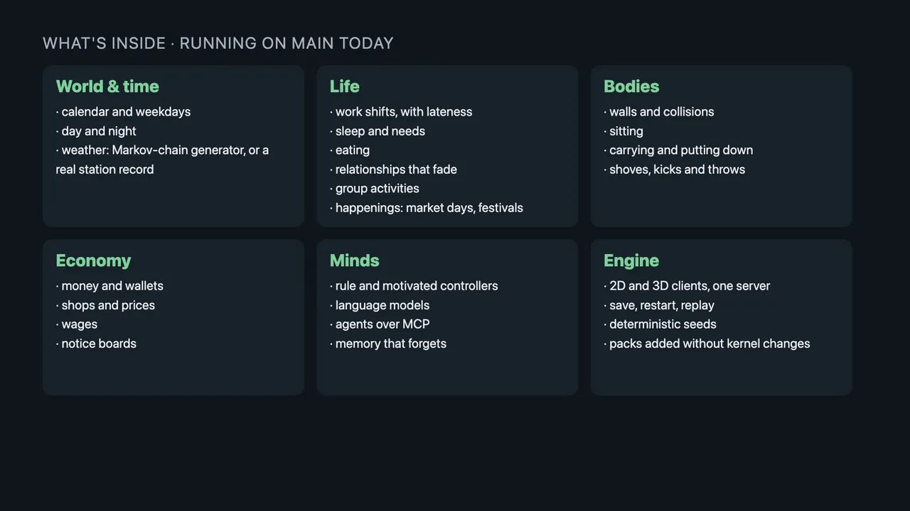
</p>

| | | |
| --- | --- | --- |
| 🧱 **Kernel** ✅<br><sub>time, space, events, persistence, replay; deterministic on macOS, Linux and Windows</sub> | 🧩 **18 System Packs** ✅<br><sub>talk, friends, items, shops, jobs, wages, food, bodies, date, weather, and a third-party fishing pack</sub> | 📜 **Interaction List** ✅<br><sub>who may do what to whom, per world, as data</sub> |
| 🗺️ **2D client** ✅<br><sub>walk, talk, invite, buy, give, eat, all through server menus</sub> | 🏙️ **3D client** ✅<br><sub>walk, run, jump, enter the café, talk, buy · 🚧 the full street, Lakeside in 3D</sub> | 🧠 **AI characters** ✅<br><sub>a local or online model, each person's own memory and forgetting · 🚧 shared memory</sub> |
| 🤖 **Agents as players** ✅<br><sub>Python library and MCP; the same seat rules as a human · 🚧 remote over HTTP</sub> | 👥 **Play together** ✅<br><sub>invite codes, reconnects, a hosted town that lives while nobody is online</sub> | 🧬 **People with depth** 🚧<br><sub>a curated attribute catalogue, population sampling, optional MatrAIx backend</sub> |

✅ works on `main` and is tested · 🚧 designed and being built. Live detail:
[`docs/MVP_STATUS.md`](docs/MVP_STATUS.md).

## Scope

The café town is the first composition, not the product. MineWorld is meant to grow into a 1:1
digital world: each new domain, from markets to politics to autonomous driving, arrives as more packs,
never as a bigger kernel.

<picture>
  <source media="(prefers-color-scheme: dark)" srcset="docs/assets/readme/scope-en-dark.svg">
  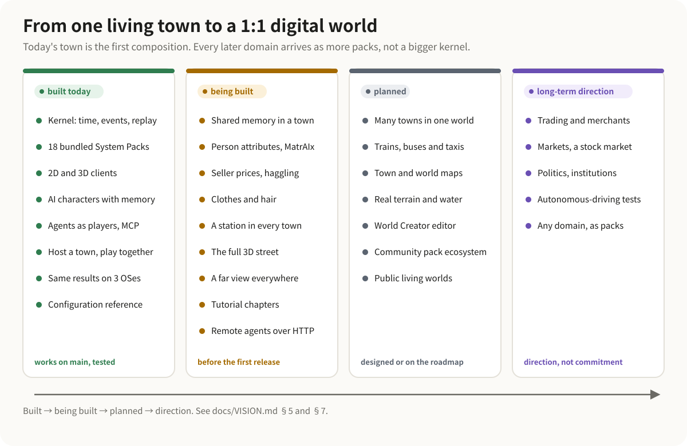
</picture>

| Stage | What | Status |
| --- | --- | --- |
| **MVP-0** | one town that lives, in 2D and 3D, alone, with friends or with agents | ✅ mostly built · 🚧 finishing |
| **Next** | many towns linked by train, bus and taxi; maps; real terrain and water | 🗺 planned ([`VISION.md` §5](docs/VISION.md#5-roadmap-beyond-the-mvp)) |
| **Later** | World Creator, a pack ecosystem, public living worlds | 🗺 planned |
| **Long-term** | trading, markets, politics, autonomous-driving tests | 🔭 direction, not commitment ([`VISION.md` §7](docs/VISION.md#7-long-term-scope-direction-recorded-2026-10-18)) |

## Learn more

- [`docs/VISION.md`](docs/VISION.md): why this exists and where it is going
- [`docs/ARCHITECTURE.md`](docs/ARCHITECTURE.md) and [`docs/CORE_CONCEPTS.md`](docs/CORE_CONCEPTS.md): how the parts fit, and the words we use
- [`docs/MODULE_SPEC.md`](docs/MODULE_SPEC.md): how to write packs, including the Interaction List
- [`docs/reference/`](docs/reference/README.md): every field a world may set, generated from the code

**Built with** Rust · Godot 4.7 · Python · SQLite · the Model Context Protocol.

**Contributing.** Read [`CLAUDE.md`](CLAUDE.md) and [`docs/ENGINEERING_RULES.md`](docs/ENGINEERING_RULES.md);
`python3 scripts/ci_layer.py fast` runs the quick checks. If you want worlds like this to exist, a ⭐
helps other people find the project.

## License

MIT, except the Blender scripts in `clients/3d-spike/tools/blender/` (GPL-2.0-or-later, because they use
Blender's GPL interface). Art from other people is CC0. Where every piece of art came from, including
the parts made with AI tools, is listed in [`NOTICE`](NOTICE). The screenshots, clips and diagrams in
`docs/images/readme/` and `docs/assets/readme/` were made for this project; the clips are cut from the
[intro video](https://github.com/yuema137/MineWorld/releases/tag/promo-v2.2), whose narration is an
AI-generated voice.
