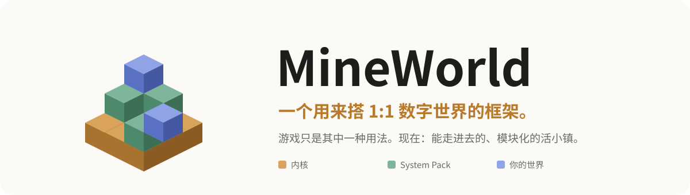

<p align="center">
  <picture>
    <source media="(prefers-color-scheme: dark)" srcset="docs/assets/readme/hero-zh-dark.svg">
    
  </picture>
</p>

<p align="center">
  <a href="https://github.com/yuema137/MineWorld/actions/workflows/ci.yml"></a>
  <a href="LICENSE"></a>
  
  
  
  
  
  
</p>

<p align="center">
  <a href="README.md">English</a> · <b>简体中文</b>
  <br>
  <a href="#快速上手">快速上手</a> ·
  <a href="#核心想法给人的世界一份-interaction-list">核心想法</a> ·
  <a href="#它是怎么工作的">怎么工作</a> ·
  <a href="#里面有什么">里面有什么</a> ·
  <a href="#范围">范围</a> ·
  <a href="docs/VISION.md">愿景</a>
</p>

> 本文是英文 [`README.md`](README.md) 的中文镜像。两者如有出入，以英文版为准。

<p align="center">
  
  <br><sub>从街上走到咖啡馆柜台，画面都是从 3D 客户端截下来的。</sub>
</p>


<table>
  <tr>
    <td width="50%"></td>
    <td width="50%"></td>
  </tr>
  <tr>
    <td align="center"><sub><b>3D</b>：走到 Alice 跟前按 E。她记得你说过的话。</sub></td>
    <td align="center"><sub><b>2D</b>：同一个小镇，同一台服务器，同一份动作菜单。</sub></td>
  </tr>
</table>

**MineWorld 是一个开源框架，用来搭一个 1:1 的数字世界：一个一直存在的世界，里面有人、地方、规则和物理，你可以走进去。游戏只是它的一种用法。** 现在它能搭的是模块化的活小镇，比如一个咖啡馆小镇和一个湖边村子。镇上的人上班、买东西、聊天、记事情，没人登录的时候也照样过日子。你可以用 2D 或 3D 来玩，可以和朋友一起玩，也可以和 AI agent 一起玩，agent 守的规则和你完全一样。完整的 1:1 范围是[方向](#范围)，不是现在的状态。

- **拼出来，不用 fork。** 一个世界就是一份 pack 清单加几个文本文件。钱、工作、身体、天气，各是一个模块。内核很小，它不知道"工作"是什么。
- **只有一个权威的世界。** 所有视图、所有 AI 角色、所有外部 agent，问的都是同一台服务器。每次变化都连同原因记下来，崩溃不丢，重放结果一样。
- **有没有 AI 都能活。** 角色可以接语言模型，带自己的记忆；也可以只跑一个简单脚本。把模型全拔掉，世界照样运转。

## 核心想法：给人的世界一份 Interaction List

做粒子物理的人，不会每做一个实验就重写一个模拟器。在 [Geant4](https://geant4.web.cern.ch) 里，他们选一份 **physics list**：哪些物理过程作用在哪些粒子上。MineWorld 对人的世界做同样的事。一个世界的 [Interaction List](docs/MODULE_SPEC.md#42-the-worlds-interaction-list) 写清楚：有哪些相互作用，在谁和谁之间，按什么规则。同一个引擎，换一份列表，就是另一个世界。

<picture>
  <source media="(prefers-color-scheme: dark)" srcset="docs/assets/readme/physics-list-zh-dark.svg">
  
</picture>

## 它是怎么工作的

<picture>
  <source media="(prefers-color-scheme: dark)" srcset="docs/assets/readme/one-world-zh-dark.svg">
  
</picture>

<picture>
  <source media="(prefers-color-scheme: dark)" srcset="docs/assets/readme/compose-zh-dark.svg">
  
</picture>

<details>
<summary><b>一个动作的一生</b>：你买一杯咖啡时发生了什么</summary>
<br>
<picture>
  <source media="(prefers-color-scheme: dark)" srcset="docs/assets/readme/action-life-zh-dark.svg">
  
</picture>
</details>

## 快速上手

你需要装好 [Rust](https://rustup.rs)（版本会自己装对）和 [Godot 4.7](https://godotengine.org)，并且能在 `PATH` 里找到它们。

```sh
git clone https://github.com/yuema137/MineWorld && cd MineWorld
./mineworld-2d               # 2D 的 market town：点地面走路，点一个人弹出菜单
./mineworld-slice --world    # 3D 走进咖啡馆，在柜台前按 E 和 Alice 说话
```

完全不要画面？让一个世界跑 30 天游戏时间，或者做一个你自己的世界：

```sh
cargo run -p mineworld-cli -- run worlds/market-town --headless --seed 7 --days 30
cargo run -p mineworld-cli -- create my-world
```

想用程序来玩，看 [`clients/agent`](clients/agent/README.md)（Python，或者用 MCP 接 Claude Code 等 agent）。想给角色接语言模型，看 [`cognition/lm-controller`](cognition/lm-controller/README.md)。一个世界能设置的每一项，都在自动生成的[参考手册](docs/reference/README.md)里。

## 里面有什么

| | | |
| --- | --- | --- |
| 🧱 **内核** ✅<br><sub>时间、空间、事件、存储、重放；在 macOS、Linux、Windows 上结果一致</sub> | 🧩 **18 个 System Pack** ✅<br><sub>说话、交朋友、物品、商店、工作、工资、吃喝、身体、日期、天气，再加一个第三方钓鱼 pack</sub> | 📜 **Interaction List** ✅<br><sub>谁能对谁做什么，每个世界自己定，写成数据</sub> |
| 🗺️ **2D 客户端** ✅<br><sub>走路、说话、邀请、买、给、吃喝，全走服务器给的菜单</sub> | 🏙️ **3D 客户端** ✅<br><sub>走、跑、跳、进咖啡馆、和 Alice 说话 · 🚧 完整的街道、买东西</sub> | 🧠 **AI 角色** ✅<br><sub>本地或在线模型，每个人有自己的记忆和遗忘 · 🚧 共享记忆</sub> |
| 🤖 **agent 当玩家** ✅<br><sub>Python 库和 MCP；座位规则和真人一样 · 🚧 走 HTTP 远程接入</sub> | 👥 **一起玩** ✅<br><sub>邀请码、断线重连、没人在线时小镇照样运转</sub> | 🧬 **有深度的人物** 🚧<br><sub>精选的属性目录、按人口抽样、可选的 MatrAIx 后端</sub> |

✅ 已在 `main` 上并有测试 · 🚧 已设计，正在做。最新细节见 [`docs/MVP_STATUS.md`](docs/MVP_STATUS.md)。

## 范围

咖啡馆小镇只是第一种组合，不是产品本身。MineWorld 要长成一个 1:1 的数字世界：以后的每个新领域，从市场到政治再到自动驾驶，都是多装几个 pack，内核不会变大。

<picture>
  <source media="(prefers-color-scheme: dark)" srcset="docs/assets/readme/scope-zh-dark.svg">
  
</picture>

| 阶段 | 内容 | 状态 |
| --- | --- | --- |
| **MVP-0** | 一个活的小镇，2D 和 3D 都能玩，可以一个人、和朋友、或和 agent 一起 | ✅ 大部分做完 · 🚧 收尾中 |
| **下一步** | 火车、公交、出租车连起来的多个小镇；地图；真实地形和水 | 🗺 计划中（[`VISION.md` 第 5 节](docs/VISION.md#5-roadmap-beyond-the-mvp)） |
| **再往后** | World Creator、pack 生态、公开的常驻世界 | 🗺 计划中 |
| **长期** | 贸易、市场、政治、自动驾驶测试 | 🔭 是方向，不是承诺（[`VISION.md` 第 7 节](docs/VISION.md#7-long-term-scope-direction-recorded-2026-10-18)） |

## 了解更多

- [`docs/VISION.md`](docs/VISION.md)：为什么做这个，要往哪走
- [`docs/ARCHITECTURE.md`](docs/ARCHITECTURE.md) 和 [`docs/CORE_CONCEPTS.md`](docs/CORE_CONCEPTS.md)：各部分怎么拼在一起，以及我们用的词
- [`docs/MODULE_SPEC.md`](docs/MODULE_SPEC.md)：怎么写 pack，包括 Interaction List
- [`docs/reference/`](docs/reference/README.md)：一个世界能设置的每个字段，从代码自动生成

**用到的技术**：Rust · Godot 4.7 · Python · SQLite · Model Context Protocol。

**参与贡献**：先读 [`CLAUDE.md`](CLAUDE.md) 和 [`docs/ENGINEERING_RULES.md`](docs/ENGINEERING_RULES.md)；`python3 scripts/ci_layer.py fast` 会跑快速检查。如果你也希望这样的世界存在，点个 ⭐ 能帮更多人找到这个项目。

## 许可证

MIT。例外是 `clients/3d-spike/tools/blender/` 里的 Blender 脚本，它们用到了 Blender 的 GPL 接口，所以是 GPL-2.0-or-later。别人做的美术素材是 CC0。每件美术素材的来源，包括用 AI 工具做的部分，都列在 [`NOTICE`](NOTICE) 里。`docs/images/readme/` 和 `docs/assets/readme/` 里的截图和示意图是为这个项目做的。
