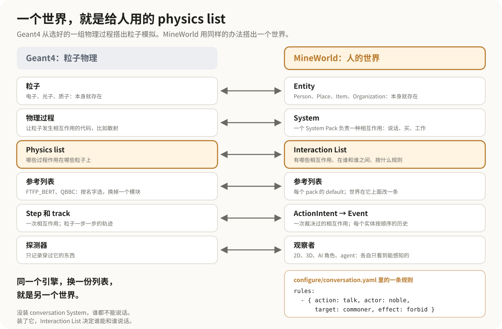
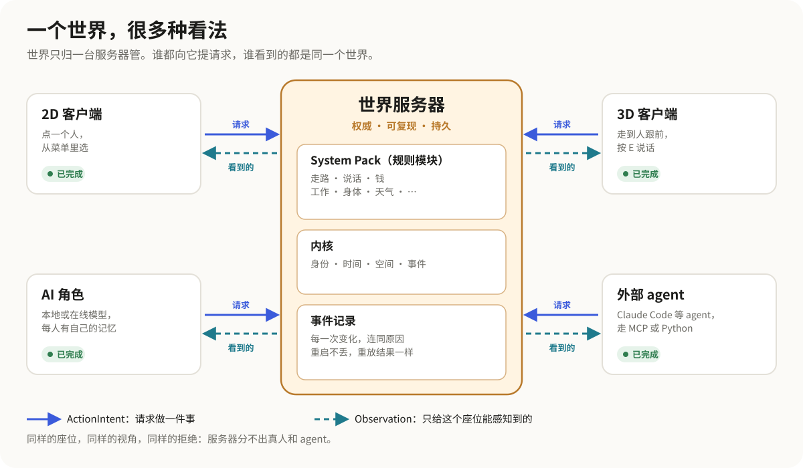
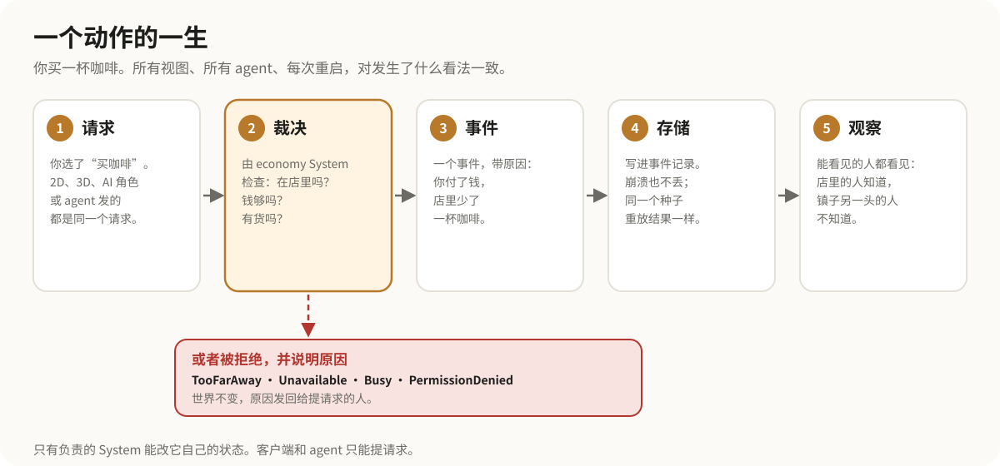
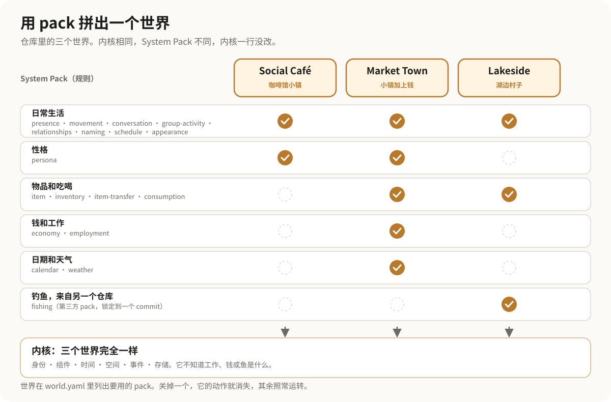
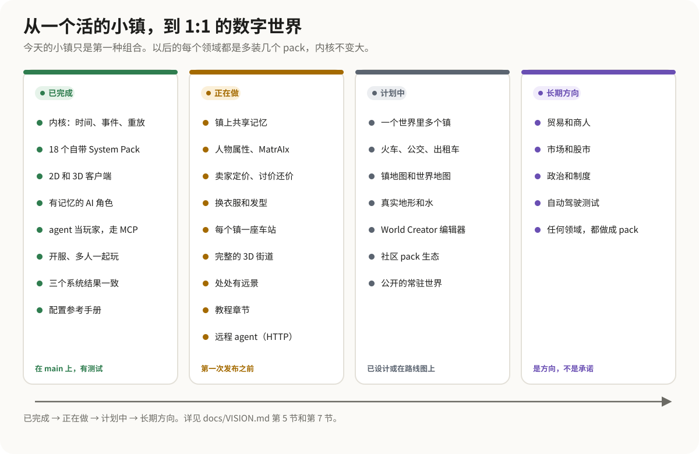

<p align="center">
  <a href="https://github.com/yuema137/MineWorld/releases/tag/promo-v2.2"></a>
  <br>
  <b><a href="https://github.com/yuema137/MineWorld/releases/download/promo-v2.2/mineworld-intro-v2.2.mp4">▶ 观看三分钟介绍视频</a></b>
  <sub>（<a href="https://github.com/yuema137/MineWorld/releases/download/promo-v2.2/mineworld-intro-v2.2.en.srt">英文字幕</a>）</sub>
</p>

<p align="center">
  <a href="https://github.com/yuema137/MineWorld/actions/workflows/ci.yml"></a>
  <a href="LICENSE"></a>
  
  
  
  
  
  
</p>

<p align="center">
  <a href="README.md">English</a> · <b>简体中文</b>
  <br>
  <a href="#一个世界很多玩家">一个世界</a> ·
  <a href="#一个自己活着的小镇">活的小镇</a> ·
  <a href="#新世界同一个引擎">新世界</a> ·
  <a href="#快速上手">快速上手</a> ·
  <a href="#里面有什么">里面有什么</a> ·
  <a href="docs/VISION.md">愿景</a>
</p>

> 本文是英文 [`README.md`](README.md) 的中文镜像。两者如有出入，以英文版为准。

**MineWorld 是一个开源框架，用来搭活的数字世界：小镇里的人上班、聊天、记事情，不管操控他们的是你、是简单的规则，还是 AI。** 你可以用 2D 或 3D 走进去，可以和朋友一起，也可以和 AI agent 一起，agent 守的规则和你完全一样。

<p align="center">
  
  <br><sub>一个小镇，同一时刻三个玩家：一个在 2D，一个在 3D 里走，还有一个 AI agent。</sub>
</p>

这个小镇不是产品本身。它只是用这个框架搭出来的一个世界，你也可以搭你自己的。

## 核心想法：给人的世界一份 physics list

做粒子物理的人，不会每做一个实验就重写一个模拟器。在 [Geant4](https://geant4.web.cern.ch) 里，他们选一份 **physics list**：哪些物理过程作用在哪些粒子上。MineWorld 对人的世界做同样的事：Entity 是粒子，System 是物理过程，一个世界的 [Interaction List](docs/MODULE_SPEC.md#42-the-worlds-interaction-list) 决定这个世界用哪些。同一个引擎，换一份列表，就是另一个世界。

<picture>
  <source media="(prefers-color-scheme: dark)" srcset="docs/assets/readme/physics-list-zh-dark.svg">
  
</picture>

这就引出三个问题。下面用真实录屏一个个回答。

## 一个世界，很多玩家

*2D、3D 和 AI 玩家怎样共用一个世界，而且永远不会对不上？*

**客户端只负责问，服务器按规则决定，并说明原因。** Vera 在门口跟 Alice 打招呼，服务器拒绝了：`too_far_away`。她走过去，再说一次，就成功了。客户端里没有任何规则。

<p align="center">
  
</p>

**一份记录，所有视图都看到。** Vera 在 3D 里买了一杯咖啡。经济 System 记下这笔账，所以她在 2D 里的钱包已经变成 2000.00 → 1999.20。

<table>
  <tr>
    <td width="50%"></td>
    <td width="50%"></td>
  </tr>
  <tr>
    <td align="center"><sub><b>3D</b>：在柜台买一杯咖啡</sub></td>
    <td align="center"><sub><b>2D</b>：同一个座位，钱包已经变了</sub></td>
  </tr>
</table>

**崩溃也抹不掉一个事实。** 所有事实都存在服务器上。走到一半用 `kill -9` 杀掉服务器，再启动，世界从同一个 revision 接着跑。客户端只是重连一下。

<p align="center">
  
</p>

<details>
<summary><b>它是怎么工作的</b>：一台权威服务器，以及一个动作的一生</summary>
<br>
<picture>
  <source media="(prefers-color-scheme: dark)" srcset="docs/assets/readme/one-world-zh-dark.svg">
  
</picture>
<picture>
  <source media="(prefers-color-scheme: dark)" srcset="docs/assets/readme/action-life-zh-dark.svg">
  
</picture>
</details>

## 一个自己活着的小镇

*没人玩的时候，是什么让小镇继续运转？*

**不是语言模型。** 把模型全拔掉，简单的规则照样让小镇运转：人们上班、吃饭、走回家、睡觉。这是下午 5 点的 Market Town，只用规则控制器。

<p align="center">
  
</p>

**每个人都跑在一个可替换的控制器上**：普通规则、会权衡自身需要的动机控制器、语言模型、外部 agent，或者你自己。换控制器不碰世界本身，只是 decisions 文件里的一行。

<p align="center">
  
</p>

**模型只是其中一种选择。** 给 Alice 接一个本地模型，在 2D 里告诉她一个消息。过一会儿在 3D 里见到她，她还记得。

<p align="center">
  
</p>

**agent 也用同样的方式接进来。** Claude Code 通过 MCP 加入，走到柜台买一杯咖啡，守的规则和你一样。Bob 在 2D 里看着这一切发生。

<p align="center">
  
</p>

## 新世界，同一个引擎

*怎样搭一个新世界，而不用重写引擎？*

**一个世界就是一份 pack 清单，跑在一个永远不变的内核上。** 下面是咖啡馆真实的 Interaction List 的开头：

```console
$ mineworld interactions worlds/market-town --place cafe
interactions  Market Town (market-town)
section  conversation: default (compiled)
section  employment: default (compiled)
section  group-activity: default (compiled)
section  needs:
section  posture: default (compiled)
section  relationships: default (compiled)
section  sleep:
…
```

社交咖啡馆里你可以坐下聊天。加上经济 pack，同一个咖啡馆就变成卖咖啡的集市小镇。再加一个第三方钓鱼 pack，就是湖边村子。内核一行都没改。

<p align="center">
  
  <br><sub>Lakeside 现在能在 2D 里玩；🚧 3D 视图正在做。</sub>
</p>

<details>
<summary><b>三个世界，一个内核</b>：每个世界用了哪些 pack</summary>
<br>
<picture>
  <source media="(prefers-color-scheme: dark)" srcset="docs/assets/readme/compose-zh-dark.svg">
  
</picture>
</details>

接下来是用火车连起来的多个区域，然后是市场和各种机构，一次加一个 pack（见[范围](#范围)）。

## 下载和玩

🚧 macOS、Windows 和 Linux 的下载会随第一个正式版本一起发布。在那之前，请用下面的快速上手。

[指南第 01 章](docs/guide/01-get-mineworld.zh-CN.md)讲了拿到 `mineworld` 命令的两种方式。

## 快速上手

你需要装好 [Rust](https://rustup.rs)（版本会自己装对）和 [Godot 4.7](https://godotengine.org)，并且能在 `PATH` 里找到它们。

3D 角色模型用 [Git LFS](https://git-lfs.com) 存放。先装一次：

- macOS：`brew install git-lfs`
- Linux（Debian 或 Ubuntu）：`sudo apt install git-lfs`
- Windows：`winget install GitHub.GitLFS`

```sh
git lfs install             # 每台电脑一次
git clone https://github.com/yuema137/MineWorld && cd MineWorld
git lfs pull                # 下载 3D 角色模型
./mineworld-2d               # 2D 的 market town：点地面走路，点一个人弹出菜单
./mineworld-slice --world    # 3D 走进咖啡馆，在柜台前按 E 和 Alice 说话
```

完全不要画面？让一个世界跑 30 天游戏时间，或者做一个你自己的世界：

```sh
cargo run -p mineworld-cli -- run worlds/market-town --headless --seed 7 --days 30
cargo run -p mineworld-cli -- create my-world
```

想一步步搭自己的世界（两个房间、三个人、一家店），跟着[教程](docs/guide/README.md)做。教程里的每条命令，CI 都会在三个平台上真跑一遍。

想用程序来玩，看 [`clients/agent`](clients/agent/README.md)（Python，或者用 MCP 接 Claude Code 等 agent）。想给角色接语言模型，看 [`cognition/lm-controller`](cognition/lm-controller/README.md)。一个世界能设置的每一项，都在自动生成的[参考手册](docs/reference/README.md)里。

## 里面有什么

<p align="center">
  
</p>

| | | |
| --- | --- | --- |
| 🧱 **内核** ✅<br><sub>时间、空间、事件、存储、重放；在 macOS、Linux、Windows 上结果一致</sub> | 🧩 **18 个 System Pack** ✅<br><sub>说话、交朋友、物品、商店、工作、工资、吃喝、身体、日期、天气，再加一个第三方钓鱼 pack</sub> | 📜 **Interaction List** ✅<br><sub>谁能对谁做什么，每个世界自己定，写成数据</sub> |
| 🗺️ **2D 客户端** ✅<br><sub>走路、说话、邀请、买、给、吃喝，全走服务器给的菜单</sub> | 🏙️ **3D 客户端** ✅<br><sub>走、跑、跳、进咖啡馆、说话、买东西 · 🚧 完整的街道、Lakeside 的 3D</sub> | 🧠 **AI 角色** ✅<br><sub>本地或在线模型，每个人有自己的记忆和遗忘 · 🚧 共享记忆</sub> |
| 🤖 **agent 当玩家** ✅<br><sub>Python 库和 MCP；座位规则和真人一样 · 🚧 走 HTTP 远程接入</sub> | 👥 **一起玩** ✅<br><sub>邀请码、断线重连、没人在线时小镇照样运转</sub> | 🧬 **有深度的人物** 🚧<br><sub>精选的属性目录、按人口抽样、可选的 MatrAIx 后端</sub> |

✅ 已在 `main` 上并有测试 · 🚧 已设计，正在做。最新细节见 [`docs/MVP_STATUS.md`](docs/MVP_STATUS.md)。

## 范围

咖啡馆小镇只是第一种组合，不是产品本身。MineWorld 要长成一个 1:1 的数字世界：以后的每个新领域，从市场到政治再到自动驾驶，都是多装几个 pack，内核不会变大。

<picture>
  <source media="(prefers-color-scheme: dark)" srcset="docs/assets/readme/scope-zh-dark.svg">
  
</picture>

| 阶段 | 内容 | 状态 |
| --- | --- | --- |
| **MVP-0** | 一个活的小镇，2D 和 3D 都能玩，可以一个人、和朋友、或和 agent 一起 | ✅ 大部分做完 · 🚧 收尾中 |
| **下一步** | 火车、公交、出租车连起来的多个小镇；地图；真实地形和水 | 🗺 计划中（[`VISION.md` 第 5 节](docs/VISION.md#5-roadmap-beyond-the-mvp)） |
| **再往后** | World Creator、pack 生态、公开的常驻世界 | 🗺 计划中 |
| **长期** | 贸易、市场、政治、自动驾驶测试 | 🔭 是方向，不是承诺（[`VISION.md` 第 7 节](docs/VISION.md#7-long-term-scope-direction-recorded-2026-10-18)） |

## 了解更多

- [`docs/VISION.md`](docs/VISION.md)：为什么做这个，要往哪走
- [`docs/ARCHITECTURE.md`](docs/ARCHITECTURE.md) 和 [`docs/CORE_CONCEPTS.md`](docs/CORE_CONCEPTS.md)：各部分怎么拼在一起，以及我们用的词
- [`docs/MODULE_SPEC.md`](docs/MODULE_SPEC.md)：怎么写 pack，包括 Interaction List
- [`docs/reference/`](docs/reference/README.md)：一个世界能设置的每个字段，从代码自动生成

**用到的技术**：Rust · Godot 4.7 · Python · SQLite · Model Context Protocol。

**参与贡献**：先读 [`CLAUDE.md`](CLAUDE.md) 和 [`docs/ENGINEERING_RULES.md`](docs/ENGINEERING_RULES.md)；`python3 scripts/ci_layer.py fast` 会跑快速检查。如果你也希望这样的世界存在，点个 ⭐ 能帮更多人找到这个项目。

## 许可证

MIT。例外是 `clients/3d-spike/tools/blender/` 里的 Blender 脚本，它们用到了 Blender 的 GPL 接口，所以是 GPL-2.0-or-later。别人做的美术素材是 CC0。每件美术素材的来源，包括用 AI 工具做的部分，都列在 [`NOTICE`](NOTICE) 里。`docs/images/readme/` 和 `docs/assets/readme/` 里的截图、短片和示意图是为这个项目做的；短片剪自[介绍视频](https://github.com/yuema137/MineWorld/releases/tag/promo-v2.2)，视频旁白是 AI 生成的语音。
