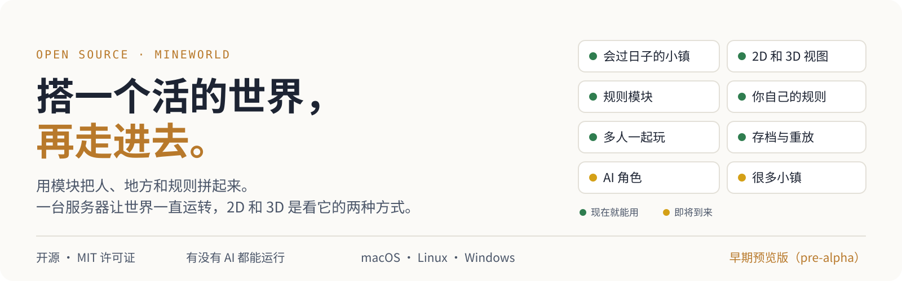
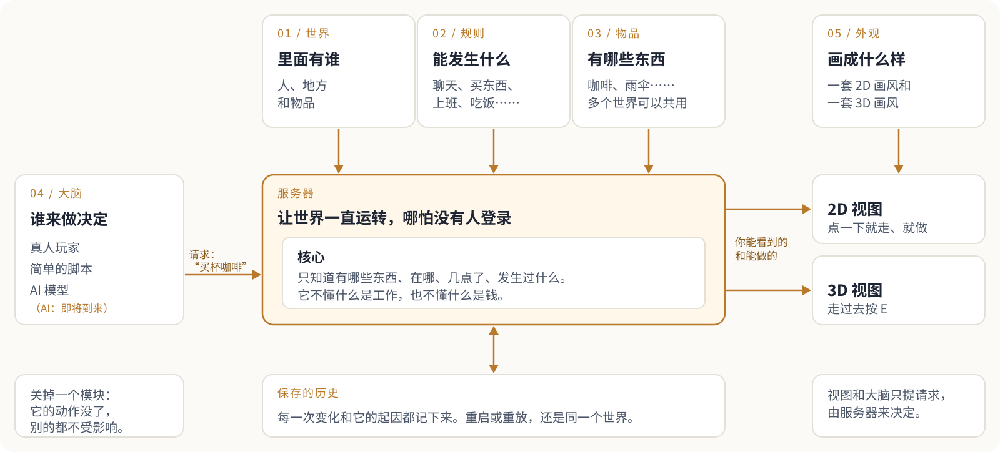
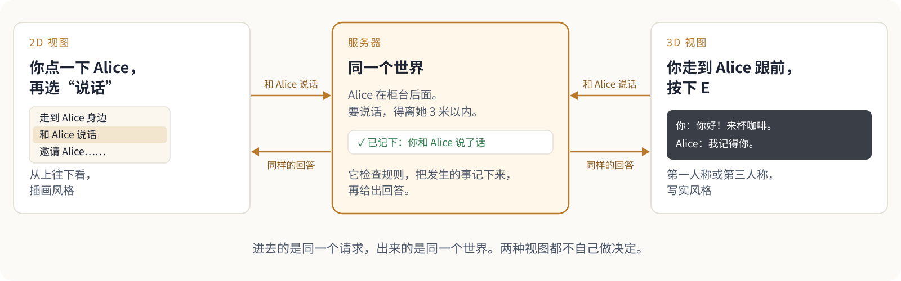

<p align="center">
  <picture>
    <source media="(prefers-color-scheme: dark)" srcset="docs/images/readme/hero-zh-dark.svg">
    
  </picture>
</p>

<p align="center">
  
</p>

<p align="center">
  <a href="LICENSE"></a>
  <a href="https://github.com/yuema137/MineWorld/actions/workflows/ci.yml"></a>
  
  
  
  
</p>

<p align="center">
  <a href="README.md">English</a> · <b>简体中文</b>
</p>

<p align="center">
  <a href="#有什么不一样">为什么选 MineWorld</a> ·
  <a href="#一个世界是怎么搭起来的">怎么搭</a> ·
  <a href="#一个世界两种视图">两种视图</a> ·
  <a href="#真人和-ai-agent-玩的是同一个游戏">Agent</a> ·
  <a href="#有深度的人物人物来源可以替换现在加入-matraix">人物</a> ·
  <a href="#看看实际画面">实际画面</a> ·
  <a href="#现在能用什么">现状</a> ·
  <a href="#快速上手">快速上手</a> ·
  <a href="#接下来往哪走">路线图</a>
</p>

> 本文是英文 [`README.md`](README.md) 的中文镜像。两者如有出入，以英文版为准。

**搭一个活的世界，再走进去。** MineWorld 是一个开源框架。你用模块拼出游戏世界，这个世界会一直存在下去。比如一个小镇：镇上的人上班、买东西、聊八卦、记事情。没有人登录的时候，他们也照样过日子。你可以用 2D 或 3D 来玩，可以和朋友一起玩，也可以和 AI agent 一起玩。agent 守的规则和你完全一样。

图里的咖啡馆小镇随 MineWorld 一起提供，装好就能玩。它只是你能搭出来的世界之一，不是产品本身。

> MineWorld 现在是 pre-alpha，也就是很早期的版本。下面每一项都标了状态：✅ 表示已经在 `main` 上能用，并且有测试；🚧 表示已经设计好，正在做。标 🚧 的东西，现在还用不了。

## 有什么不一样

| | |
| --- | --- |
| **是框架，不是一款游戏** | 你做的是拼世界：装模块，写几个文本文件，改配置，然后运行。你不用把某个游戏的代码复制一份（fork），再去改它。✅ |
| **规则就是模块** | 钱、工作、交情、身体、天气，各是一个模块。每个模块只管世界里属于自己的那一部分。关掉一个模块，它提供的动作就消失了，小镇的其他部分照常运转。核心很小，它永远不知道工作是什么、钱是什么。✅ |
| **真人和 AI agent 都是玩家** | agent 和真人走同一扇门入座。它只看得到这个人能看到的东西；被拒绝时，听到的理由也和真人一样。服务器分不出谁是真人、谁是 agent。✅ Python 库 · 🚧 MCP 适配器，给 Claude Code 等 agent 用 |
| **会记事的人** | 每个人都有自己的记忆，记着自己看到和听到的事。他们会像人一样遗忘，记忆占用的空间也有上限。驱动一个人的，可以是语言模型、简单的脚本，也可以是完全不用 AI 的决策模型。✅ · 🚧 共享记忆 |
| **有深度的人物** | 每个人可以带一组丰富的属性，比如作息类型、饮食、性格、技能……这些属性按真实的人群分布来抽取。你可以用 MineWorld 自带的属性表，也可以打开 MatrAIx 的人物 schema，它有 1,290 个维度。🚧 |
| **真正的经济** | 钱、商店、工资和库存，现在就有。✅ 接下来要做：货币由数据来定义；每个卖家自己定价；可以讨价还价；还有一位市场播报员，大家可以订阅他发的价格公告。🚧 |
| **持久的世界** | 每一次变化，都和它的起因一起被记下来。程序崩溃了，世界也不会丢。用同一个随机种子重放，结果分毫不差。在 macOS、Linux 和 Windows 上，跑出来的结果也一样。✅ |
| **一个世界，两种视图** | 2D 和 3D 视图是同一台服务器的两扇窗。两边都不自己另定规则。✅ |

## 一个世界是怎么搭起来的

<picture>
  <source media="(prefers-color-scheme: dark)" srcset="docs/images/readme/how-it-works-zh-dark.svg">
  
</picture>

一个世界由五种包（pack）拼成。一个包，就是你加进项目里的一个文件夹（[`docs/MODULE_SPEC.md`](docs/MODULE_SPEC.md)）。括号里是这种包在文档里的正式名字：

1. **世界**（`World Pack`）：世界里有谁。人、地方和物品，都用简短的文本文件写出来。
2. **规则模块**（`System Pack`）：世界里能发生什么。每个模块只管自己那一部分。比如工作模块要给 Alice 发工资，它只会说一句“Alice 的工资该发了”。真正动钱的，只有钱的模块。
3. **物品种类**（`Entity Pack`）：咖啡、雨伞、书。好几个世界可以共用同一份。
4. **大脑**（`Controller Pack`）：由谁来决定一个角色做什么。可以是真人玩家、脚本、AI 模型，也可以是外部的 agent。
5. **外观**（`Presentation Pack`）：世界画成什么样。一套 2D 画风，一套 3D 画风。

<details>
<summary><b>现有的规则模块</b></summary>

```text
presence        人在哪里，每个人能看到什么
movement        走路，以及哪些地方互相连通
conversation    聊天，并记住谁说过什么
group-activity  邀请别人，一起做事
relationships   谁认识谁，关系有多近
naming          每个人叫什么
schedule        每个人一天的安排
item            有哪些种类的物品
inventory       谁身上带着什么
item-transfer   把东西送给别人
employment      工作和班次
economy         钱、商店和工资
consumption     吃和喝
bodies          身体之间不会重叠；推、踢、扔、撞开；走路时绕开家具
calendar        日期和太阳
weather         逐小时的天气，或者重放真实气象站的记录
fishing         第一个在本项目之外做出来的模块，放在它自己的 repo 里
```

示例世界：[`worlds/social-cafe`](worlds/social-cafe)（咖啡馆小镇）；[`worlds/market-town`](worlds/market-town)（同一个小镇，加上了个人物品、工作、钱和食物）；[`worlds/bodies-yard`](worlds/bodies-yard)（两个房间，人和箱子会互相挡路）。

一个世界在 `world.yaml` 里列出它用到的模块。集市小镇就是咖啡馆小镇再加六行：

```yaml
systems:
  - presence
  - movement
  - conversation
  # … 咖啡馆小镇的其余模块
  - item
  - inventory
  - item-transfer
  - economy
  - employment
  - consumption
```

要写一个新的规则模块，分三步：在 `systems/` 下加一个文件夹，在 `systems/installed/` 下加两行，然后重新编译。具体做法见 [`systems/README.md`](systems/README.md) 里的“Adding a pack”一节。

</details>

## 一个世界，两种视图

<picture>
  <source media="(prefers-color-scheme: dark)" srcset="docs/images/readme/two-views-zh-dark.svg">
  
</picture>

服务器收到每个请求，都会给一个回答：要么告诉你发生了什么，要么告诉你为什么不行，比如“离得太远”“这里不允许”。**下面是集市小镇的一个早晨：**

1. 05:30，Alice 的班开始了。她走到咖啡馆的柜台，因为她的每日安排里是这么写的。
2. 你走进店里，打开菜单，上面有“买咖啡”。这一项是钱的模块给的：只要人在商店里，谁都能看到它。
3. 你选了它。服务器查你的钱包，扣掉价钱，给你一杯咖啡，再把发生了什么、为什么发生记下来。
4. 咖啡馆少了一杯咖啡。其他玩家都看得到。服务器重启以后，这件事也还是这样。
5. 14:00，工作模块报告 Alice 的工资该发了，钱的模块把工资付给她。然后她走去公园。

现在只能在 2D 视图里买东西，3D 里的购买还在做。把钱的模块关掉，第 2 步就不会出现，小镇的其他部分照样运转。

## 真人和 AI agent 玩的是同一个游戏

外部的 agent 是**玩家**，不是握着管理员权限的提线木偶。这个 agent 可以是一个 agent 框架、一段脚本，很快也可以是 Claude Code 或 Codex。它凭邀请进入一个座位，看到的是这个人自己的视角，只能从世界给出的选项里挑。服务器检查它的每个请求，和检查真人的请求完全一样。真人可以接管 agent 的座位，反过来也行。世界不会停下来，等谁想好再走。

| | 状态 |
| --- | --- |
| Python `Player` 库（[`clients/agent`](clients/agent/README.md)）：入座、观察、行动，断线后接着玩。它看到的信息很全：钱、物品、工作、日程、熟人、邀请、天气、价格 | ✅ [#204](https://github.com/yuema137/MineWorld/pull/204) |
| 座位授权：房主只把指定的座位交给 agent。每个座位还有请求额度。真人和 agent 用的是同一套规则 | ✅ [#205](https://github.com/yuema137/MineWorld/pull/205) |
| MCP 适配器。MCP 是一个通用协议，让 AI 工具能接上外部程序。有了这个适配器，Claude Code 和其他支持 MCP 的 agent 就能通过 stdio 来玩。还有一个脚本驱动的 MCP 试玩测试，在三个系统上都跑 | 🚧 已设计并冻结（[step 27](.structured-coding/plans/mvp0/step-27-agent-players.md)） |
| 远程 agent 通过 Streamable HTTP 接入；一章教程“以 agent 身份来玩” | 🚧 已设计 |

## 有深度的人物：人物来源可以替换（现在加入 MatrAIx）

一个小镇显得活，是因为里面的人各不相同，而且你能看出来：谁天一亮就起床，谁点燕麦奶，谁拉着你说个没完，谁会烤面包。MineWorld 给每个人一组**属性**。属性就是普通的数据，按真实的人群分布抽出来。每个世界还可以自己选择**这些人从哪里来**。

> 🚧 **状态：设计已由项目负责人在 2026-10-15 批准，正在实现。** 下面每一部分，包括 MatrAIx backend 和它的演示，不做完就不发布 MVP-0。
> 设计文档：[step 30](.structured-coding/plans/mvp0/step-30-person-attributes.md)。

- **自带一份精选的属性表。** 最多 100 个属性，分成六组：外貌、背景、心理、能力、行为、生活方式。一个属性要留下来，游戏里必须有东西真正读它：一个决定、一段对话、一个价格，或者一个人的长相。
- **自己加属性，不用写代码。** 往世界的 `attributes/` 文件夹里放一个 YAML 文件，`freckles`（雀斑）这个属性就有了。它可以被抽取，也会出现在别人看到的信息里。
- **真实的人群分布。** 世界指定一份人群分布，里面的数字都注明出处。所有角色由同一个抽样器来填。这个抽样器是确定的：输入一样，抽出来的结果就一样。一个人自己的文件里已经写明的内容，抽样器绝不改写。
- **backend 可以替换，还有 mask。** 世界先选一个人物生成 backend，再选一个 mask。mask 是一份清单，决定这个世界里有哪些属性。mask 没选上的属性，在这个世界里根本不存在：任何 prompt、视图或面板都带不出它。
- **大家看到的是同一份。** 一个人身上你能注意到的东西，会出现在这几处：2D 和 3D 的查看面板，AI 角色的“我看到了谁”，还有 agent 看到的这个人的信息。

### MatrAIx：一个可选的 backend

[MatrAIx](https://github.com/MatrAIx-ai/MatrAIx-Persona-8B) 是一个大规模的人物模型。它的 schema 是一份描述人的字段清单，用 **1,290 个维度** 来描述一个人。这些维度分成**五组**：背景、心理、能力、行为与互动、生活方式。每个取值都配一句自然语言的描述。标签有六种语言版本，其中包括简体中文。MineWorld 将让任何世界都能打开它：

```yaml
# worlds/<your-world>/configure/attributes.yaml
backend: matraix          # 默认：mineworld
mask: matraix-core-100    # 或者：all
```

- **原样导入。** 他们的 schema 以 MIT 许可证发布。导入时固定在上游的一个确切 commit 上，并且逐字节核对。维度 id、取值、描述和各语言的标签，都保持原样。
- **mask。** `matraix-core-100` 是默认的 mask，它挑出大约 100 个会改变玩法的维度，每个都写明了为什么选它。`all` 打开所有导入的维度。另外有 50 个维度带着自己的许可声明，范围比 MIT 更窄。确认这些条款之前，它们不导入，所以目前 `all` 是 1,240 个维度。
- **一个演示世界** `worlds/matraix-demo`。它展示 MatrAIx 生成的人会出现在哪些地方：选角，AI 角色的“我是谁”和“我看到了谁”，agent 的视图，以及两种视图的查看面板。中文界面也包括在内。教程里有一章，带你把这个 backend 打开，再关回去。
- **绝不是硬依赖。** 它是一个单独的包，默认不安装。没有它，MineWorld 照样能编译，完整的测试也全部通过。这个包以外，没有任何东西依赖它。

*Optional person-generation backend built on the MatrAIx persona schema (Li, Hao et al., 2026,
[arXiv 2608.04205](https://arxiv.org/abs/2608.04205); MIT), imported unchanged.* Thank you to the
MatrAIx authors for releasing their schema openly: see their paper, *MatrAIx: Simulating the World
with 8.3 Billion Persona Agents*, and their
[repository](https://github.com/MatrAIx-ai/MatrAIx-Persona-8B).

## 活生生的人

| | 状态 |
| --- | --- |
| 每个人有自己的记忆：记下自己感知到的事，随着时间压缩，回想时按相关程度来找 | ✅ [#143](https://github.com/yuema137/MineWorld/pull/143) |
| 像人一样遗忘：熟人会慢慢淡忘；遗忘的规则可以替换；可以选择让模型写摘要。默认每人最多 20 MiB | ✅ [#186](https://github.com/yuema137/MineWorld/pull/186), [#188](https://github.com/yuema137/MineWorld/pull/188), [#201](https://github.com/yuema137/MineWorld/pull/201), [#213](https://github.com/yuema137/MineWorld/pull/213) |
| 每个人的决策模型都可以替换，其中自带一个完全不用 AI 的 | ✅ [#191](https://github.com/yuema137/MineWorld/pull/191), [#210](https://github.com/yuema137/MineWorld/pull/210) |
| 由语言模型驱动的 AI 角色：默认用你自己电脑上的模型，也可以用你自己的 key 接 11 家在线服务中的一家。测试只重放录好的回答，从不调用真实的模型 | ✅ [#120](https://github.com/yuema137/MineWorld/pull/120), [#126](https://github.com/yuema137/MineWorld/pull/126), [#207](https://github.com/yuema137/MineWorld/pull/207) |
| 整个小镇共享的记忆，只存一份。能不能读到一段记忆，只看你有没有亲身感知到它 | 🚧 已写好规格（[step 28](.structured-coding/plans/mvp0/step-28-shared-memory.md)） |
| 每个人都按主角的标准来做，角色来源可以替换 | 🚧 评审中（[step 26](.structured-coding/plans/mvp0/step-26-cast.md)） |
| 换衣服和发型、初始服装、买衣服 | 🚧 已设计（[step 32](.structured-coding/plans/mvp0/step-32-wardrobe.md)） |

## 看看实际画面

所有图片都是在本项目自己的 2D 和 3D 视图里截的。

| | |
| --- | --- |
|  |  |
| **主街，3D。** 可以用第一人称走，也可以用第三人称走。 | **和 Alice 聊天，3D。** 连着一台正在运行的服务器。她记得你说过的话。 |
|  |  |
| **咖啡馆里面，3D。** 从正门走进去，四处看看。 | **你的角色，3D。** 默认的玩家角色，站在咖啡馆里。 |
|  |  |
| **同一个小镇，2D。** 从上往下看，还能看到住在这里的人。 | **服务器给的菜单，2D。** 此刻你能和 Alice 做什么。 |
|  |  |
| **买东西，2D。** 你的钱，你身上带的东西，还有这里在卖什么。 | **一家咖啡馆，两种视图。** 同一个世界，画了两遍。 |

## 现在能用什么

✅ 已经在 `main` 上能用，有测试 · 🚧 已经设计好，正在做 · 🗺 下一阶段的计划

| 方面 | 状态 |
| --- | --- |
| **核心** | ✅ 世界时钟；需要花一段时间的活动；每一次变化和它的起因都有完整记录，压缩存储。世界扛得住程序崩溃，用同一个随机种子重放，结果分毫不差 |
| **用积木搭世界** | ✅ 有测试证明：集市小镇 = 咖啡馆小镇 + 六个规则模块 + 一些设置，核心一行没改。去掉其中任何一个模块，小镇照样能运转 |
| **日常生活** | ✅ 人们走路、聊天、相识、成为朋友、一起做事、拥有和赠送东西、上班、领工资、买东西、吃喝，连续过 300 个游戏日 |
| **身体** | ✅ 人和物体永远不会互相穿过；可以推、踢、扔、撞开；走路的路线会绕开墙和家具 · 🚧 小镇里的墙 |
| **时间和天气** | ✅ 日期、星期几、日出日落；逐小时的天气，集市小镇重放的是圣地亚哥一个真实气象站的记录 · 🚧 在 2D 和 3D 视图里显示天气 |
| **活生生的人** | ✅ 记忆、遗忘、每人 20 MiB 的上限、可替换的决策模型、用本地或在线模型的 AI 角色 · 🚧 共享记忆；你在 2D 里告诉 Alice 的话，她在 3D 里还记得 |
| **agent 当玩家** | ✅ Python `Player` 库、座位授权、每个座位的请求额度 · 🚧 MCP 适配器 |
| **人物属性** | 🚧 精选属性表、自己加的属性、人群抽样、可选的 MatrAIx backend 和它的演示世界 |
| **经济** | ✅ 钱、商店、库存和工资 · 🚧 由数据定义的货币、卖家自己定价、讨价还价、价格播报员和公开公告（[step 31](.structured-coding/plans/mvp0/step-31-wealth-prices.md)） |
| **你自己的规则** | ✅ 第一批可以调的规则（比如一个人说完话，要隔多久才能再开口）· 🚧 其他模块的规则、世界事件，还有两个示例世界：一座讲究礼数的庄园，一座溜冰场 |
| **扩展包** | ✅ 每个模块都有名字、版本号和许可证；世界写明自己需要哪些版本；不用重新编译就能加新的物品种类；可以用别的 repo 里的模块，并固定到确切的版本 |
| **一起玩** | ✅ 邀请码、昵称、断线后 30 秒内可以回来、真人接管 AI 角色、房主可以暂停游戏或请人离开；没人在线时，托管的小镇照样过日子；每个人只会知道自己能看到、能听到的事 · 🚧 四个人同时在线的测试 |
| **2D 视图** | ✅（预览版）走路、开门进出、聊天、邀请、买东西、送东西、吃喝，全都通过服务器给出的菜单来做 |
| **3D 视图** | ✅ 走、跑、跳，走进咖啡馆，在运行中的服务器上和 Alice 聊天 · 🚧 整条街按服务器的地图搭出来、买东西、在普通电脑上也流畅、每个世界都有远景 |
| **小镇** | 🚧 每个小镇都有一座火车站，它同时是小镇的标志性建筑；集市小镇的车站以圣地亚哥的 Santa Fe Depot 为原型（[step 29](.structured-coding/plans/mvp0/step-29-station-landmark.md)） |
| **设置** | ✅ 在任一视图里按 Esc：英文或简体中文、12 或 24 小时制、窗口和显示选项、鼠标灵敏度、反转 Y 轴。两种视图共用同一套设置 |
| **创建世界** | ✅ 自动生成的 AI 角色配置参考；一个运行器，在 CI 里把教程的每一步都实际执行一遍（CI 是每次改动后自动跑的检查）· 🚧 教程章节本身 |
| **电脑** | ✅ 同一个世界在 macOS、Linux（Intel 和 ARM）和 Windows 上给出完全相同的结果，每次改动都会检查 · 🚧 在 Windows 上跑完整的测试 |
| **很多小镇** | 🗺 下一阶段：一个世界里有好几个小镇；火车、公交和出租车；在车上走动；小镇地图和世界地图 |
| **看起来像真的** | 🗺 下一阶段：用真实高度数据做的山、能蹚的水、随服务器里的风摆动的树 |

更多细节：[`docs/MVP.md`](docs/MVP.md)（§9，验收标准）和 [`docs/MVP_STATUS.md`](docs/MVP_STATUS.md)。

## 快速上手

你需要装两样东西：[Rust](https://rustup.rs)（合适的版本会自动装上），以及 [Godot 4.7](https://godotengine.org)。Godot 要放进 `PATH`，让命令行能直接找到它。

```sh
# 1. 拿到代码
git clone https://github.com/yuema137/MineWorld && cd MineWorld

# 2. 用 2D 玩集市小镇（点地面走路，点一个人弹出菜单，按 Q 打开自己的菜单，
#    按 Esc 打开设置，里面可以切换到简体中文）
./mineworld-2d

# 3. 用 3D 走进咖啡馆，在柜台前按 E，和 Alice 说话
./mineworld-slice --world
```

不要任何画面，让集市小镇跑 30 个游戏日，再看看发生了什么：

```sh
cargo run -p mineworld-cli -- run worlds/market-town --headless --seed 7 --days 30
```

搭一个你自己的世界。然后用文本文件添加人、地方和物品，再在它的 `world.yaml` 里打开需要的模块：

```sh
cargo run -p mineworld-cli -- create my-world
cargo run -p mineworld-cli -- validate my-world
cargo run -p mineworld-cli -- run my-world --headless --seed 1 --days 7
```

想一步一步搭一个世界（两个房间、三个人、一家小店），就跟着教程走：[`docs/guide/`](docs/guide/README.zh-CN.md)。世界里每个文件能写哪些字段，都列在自动生成的[参考手册](docs/reference/README.md)里（英文）。

想用程序来玩，看 [`clients/agent`](clients/agent/README.md)。想给角色接上语言模型，看 [`cognition/lm-controller`](cognition/lm-controller/README.md) 和自动生成的[配置参考](docs/reference/cognition-toml.md)。

**支持哪些电脑。** MineWorld 是为 macOS、Linux 和 Windows 做的。目前它在 macOS 上开发和游玩；三个系统上结果是否一致，有自动检查。想用 Docker 托管咖啡馆小镇，先运行 `docker build --target runtime -t mineworld .`，再运行 `docker run -p 7878:7878 -v mineworld:/var/lib/mineworld mineworld`。

## 接下来往哪走

<picture>
  <source media="(prefers-color-scheme: dark)" srcset="docs/images/readme/roadmap-zh-dark.svg">
  
</picture>

**第一次公开发布（MVP-0）之前**，要做完上面所有标 🚧 的东西：通过 MCP 接入的 agent、共享记忆、人物属性和 MatrAIx backend、卖家自己定价和讨价还价、衣柜、每个小镇的车站和地标、每条地平线上的远景，以及每个人都按同一个标准来做。

**再往后：**

- **很多小镇连成一个大世界。** 路上要花世界里的时间。在火车上，你可以走动，可以跟别的乘客聊天。
- **贴近真实世界。** 物理数值都来自真实的测量，并且写明出处（一个人的肩宽大约 50 厘米）。太阳按小镇的真实位置升起落下。
- **规则、画风、角色，都由你定。** 世界的作者选画风，选模块，也定下谁能对谁做什么。就算完全不用 AI，世界照样能运转。

完整的设想见 [`docs/VISION.md`](docs/VISION.md)。

## 延伸阅读

以下文档都是英文：

- [`docs/VISION.md`](docs/VISION.md)：为什么做这个项目，要往哪里走
- [`docs/ARCHITECTURE.md`](docs/ARCHITECTURE.md)：各部分怎么配合
- [`docs/CORE_CONCEPTS.md`](docs/CORE_CONCEPTS.md)：本项目用到的词，以及每个词的定义
- [`docs/MODULE_SPEC.md`](docs/MODULE_SPEC.md) 和 [`docs/PACKAGE_FORMAT.md`](docs/PACKAGE_FORMAT.md)：怎么写包
- [`CLAUDE.md`](CLAUDE.md) 和 [`docs/ENGINEERING_RULES.md`](docs/ENGINEERING_RULES.md)：每一份贡献都要遵守的规则。在自己电脑上运行 `python3 scripts/ci_layer.py fast`，可以跑一遍较快的检查

## 许可证

MIT。例外是 `clients/3d-spike/tools/blender/` 里的 Blender 脚本：它们用到了 Blender 的 GPL 接口，所以采用 GPL-2.0-or-later。来自他人的美术素材是 CC0。每一份美术素材从哪来，包括用 AI 工具做的部分，都列在 [`NOTICE`](NOTICE) 里。`docs/images/readme/` 里的截图和示意图，都是为本项目制作的。
